# How each method works

This page explains every decision mechanism in the benchmark, with one diagram per experiment.
Results: [C-series + BANKING77 (2026-10-14)](results/2026-10-14-c-series-banking77/README.md).

All methods answer the same bounded question: given a **state** (e.g. contract clauses plus a
scenario, or a customer message) and a fixed list of **K options** (labels, optionally with a
description), return a probability for each option.

The methods fall into separate parts that are evaluated and reported separately, never
ranked against each other:

- **Part 1 — products and baselines (A, B, S):** hosted models called through APIs (GPT-6 Luna,
  Microsoft-Decision-1, `text-embedding-3-large`). We control only the request.
- **Part 2 — open-weight model (C):** one local model, `openai/gpt-oss-20b`, with identical
  weights in every experiment. Only the readout changes.
- **Part 3 — replication study (R):** probes of Decision-1 itself, its frozen base model
  (Qwen3.5-9B) and small trained deciders, to understand how decision models work.

## Key terms

- **Readout:** how a decision is extracted from a model. The same network can be asked to write
  the answer as text, have each label's likelihood scored, have one token's probabilities read
  after listing the options, or have a small trained layer applied to its internal activations.
  Each of these is a different readout of the same model.
- **Calibration:** whether the probabilities mean what they say. If a method says "90% sure" on
  100 decisions, about 90 of them should be correct. Accuracy says how often the top answer is
  right; calibration says whether the confidence can drive a policy (automate above a
  threshold, escalate below it). We measure it with ECE (gap between stated confidence and
  observed accuracy) and NLL (log-loss), and fix systematic over/under-confidence with
  *temperature scaling* fitted on the separate calibration split. AURC measures a related
  property: whether errors get lower confidence than correct answers.
- **Zero-shot vs. supervised:** supervised methods fit parameters on the dataset's `train`
  labels and are marked as such in every leaderboard. Zero-shot methods use no labels.

# Part 1 — Products and baselines (A, B, S)

| Experiment | Model | What happens per decision | Trained on labels? |
|---|---|---|---|
| A1, A1v | GPT-6 Luna (Azure OpenAI) | 1 generation: reasoning + answer text, parsed to a label | no |
| B1 (A2 blocked on Azure) | Microsoft-Decision-1 (Azure AI Foundry) | 1 decision-API call returning a probability per option | no |
| S1 | text-embedding-3-large | 1 embedding call + similarity or a small classifier | label similarity: no; centroid/kNN/logreg: **yes** |

## A1 / A1v — GPT-6 Luna, generate the label (API)

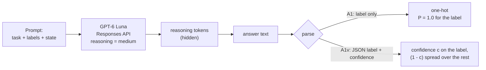

The standard way to classify with an LLM. A1 returns only a label, so its "probabilities" are
one-hot. A1v asks the model to also state a confidence (verbalized confidence). GPT-6 Luna does
not expose logprobs for reasoning models, so a Jev-style readout on top of it (A3) is not
possible on Azure.

## B1 — Microsoft-Decision-1 (decision API)

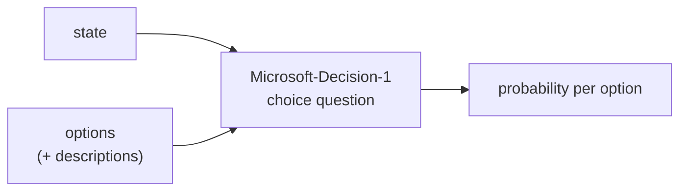

A purpose-built decision model on Azure AI Foundry: the state and the options go in, a
distribution comes out. No text is generated or parsed. Its internals are not documented. The
OpenAI Decisions API (A2, the same idea on GPT-6 Luna) returns 404 on Azure and is disabled.

## S1 — Embedding baselines

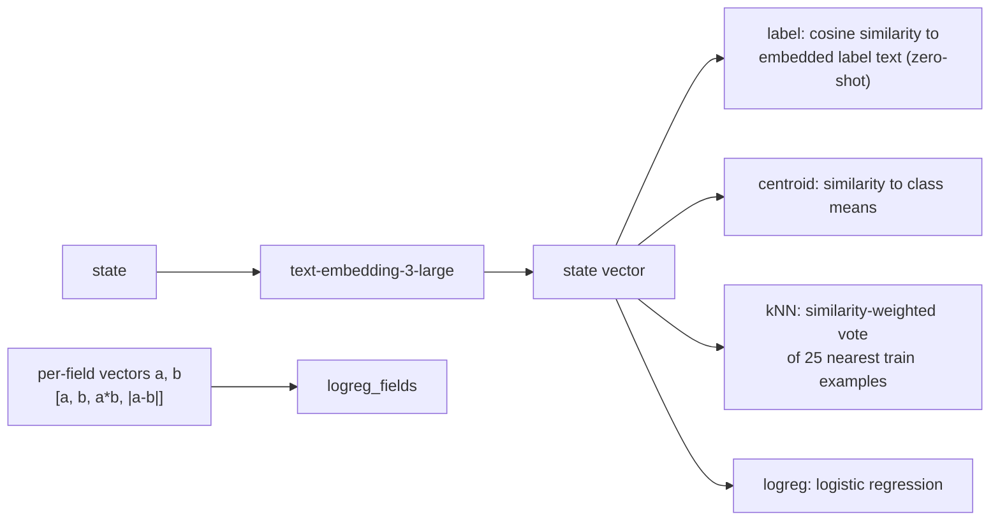

Bi-encoder baselines: the state is embedded once; options are not seen by the encoder (except in
zero-shot label similarity). Centroid, kNN and logistic-regression heads are fit on train
(`supervised`). `logreg_fields` embeds each state field separately (ACE: clauses and scenario)
so the probe can model their interaction.

---

# Part 2 — Open-weight model: gpt-oss-20b readouts (C)

| Readout family | Experiments | Model calls per decision | Trained on labels? |
|---|---|---|---|
| Generate text, parse the label | C1 | 1 generation (reasoning + answer) | no |
| Score each label as a continuation | C2, C3, C2+ | K label continuations (C3 shares the prompt) | no |
| Judge each candidate Yes/No | C4 | K short continuations (shared prompt) | no |
| List the options, read one token | C6, C6+ | 1 forward pass (C6+: 3–4 orderings) | no |
| Reason, then read one token | C8 | 1 generation of the reasoning + 1 read | no |
| Cascade | C9 | C6+ always, C8 only when unsure | no (threshold fit on calibration) |
| Linear head on hidden states | C5, C7 | 1 forward pass (C7: only the first L layers) | **yes** (train split) |

## Shared prompt conventions (gpt-oss-20b)

All C-methods use the same local model (`openai/gpt-oss-20b`: 24 layers, bf16 on one A100 80 GB)
and the same [harmony](https://github.com/openai/harmony) chat format: a system message (fixed
date, reasoning effort `low`), developer instructions (the task plus either the label list or a
listed-options instruction) and the state as the user message. The prompts are generic and come
from the dataset config; nothing is specific to a dataset.

gpt-oss writes a private **analysis** channel (its reasoning) before the **final** channel (the
answer). Several methods skip the reasoning entirely by placing the model directly at the start
of the final answer (`<|start|>assistant<|channel|>final<|message|>`) and reading probabilities
there.

Two prompt layouts are used:

```text
Label prompt (C1, C2, C3, C2+)            Listed-options prompt (C5, C6, C6+, C7, C8)
------------------------------            -------------------------------------------
task instructions                         task instructions
allowed labels (+ descriptions)           "answer with the letter of the correct option"
state                                     state
                                          Options:
                                          [A] Compliant: <description>
                                          [B] Non-Compliant: <description>
                                          [C] Not-Applicable: <description>
-> answer is the label text               -> answer is a single marker token (A..Z, or 1..K for K > 26)
```

Every marker (`A`–`Z`, `1`–`100`) is a single token in the gpt-oss tokenizer, so one next-token
distribution gives a probability for every option.

## C1 — Autoregressive generation (gpt-oss-20b)

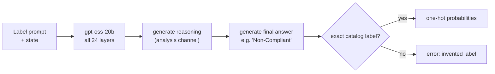

The standard way to classify with an LLM, and the reference point for every other C readout. Greedy
decoding with reasoning effort `low` (median 29 generated tokens on BANKING77, 67–70 on ACE,
reasoning included). The answer can be any text,
so it can name a label that does not exist (this happened 30 times on BANKING77, e.g.
`get_virtual_card` instead of `getting_virtual_card`).

## C2 — Candidate sequence likelihood

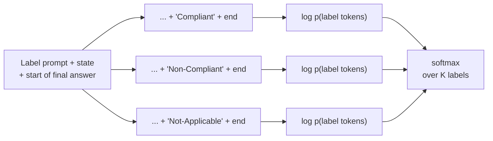

No generation: the model is placed at the start of its final answer and each label is *forced*
as the continuation (followed by the end-of-answer token). The summed token log-probability of
each label becomes its score, and a softmax over the scores gives the distribution. Each
candidate is a separate sequence (batched, 16 per batch), so the prompt is processed K times.

## C3 — Shared-prefix (KV-cache) scoring

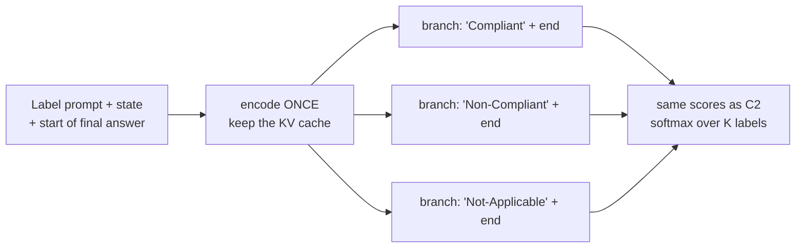

Mathematically identical to C2, but the shared prompt is encoded once and its key/value cache is
reused for every candidate. Only the label tokens are processed per candidate. This tests whether
"encode the state once, score the options cheaply" (the shared-state idea behind decision
models) changes the answers. Within bf16 rounding it does not.

## C2+ — Sequence likelihood with a content-free prior

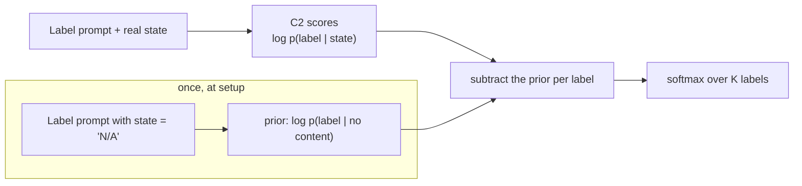

Contextual calibration (Zhao et al., 2021): measure how much the model likes each label when the
input carries no information, and subtract that bias. Known flaw: the content-free input `N/A`
reads as "not applicable", so on ACE the prior almost entirely favours the `Not-Applicable` label
and the correction removes that label from the predictions (see the results write-up).

## C4 — Cross-encoder (per-candidate Yes/No)

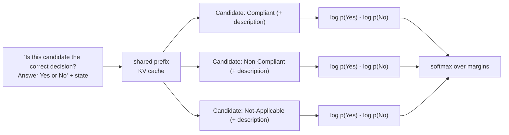

Like a reranker: the model judges each candidate on its own and never sees the alternatives.
The Yes-vs-No margin is the candidate's score.

## C5 — Listwise head on frozen hidden states (supervised)

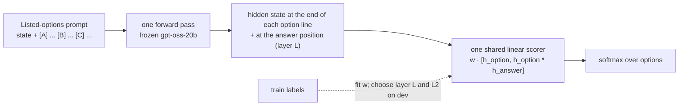

All options are in the prompt, so because of causal attention each option's representation has
read the state and the options before it (listwise). The base model stays frozen; only a single
weight vector shared by all options is trained. The layer is chosen on dev from {8, 12, 16, 20, 24}:
layer 16 on ACE and 24 on BANKING77.

## C6 — Option-letter readout (one forward pass)

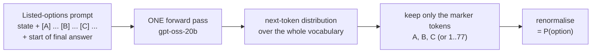

The closest zero-shot analogue of a "System One" decision: one parallel pass over the prompt, no
generated tokens, a full distribution over the options at once. The cost does not depend on the
number of options beyond listing them in the prompt.

## C6+ — Debiased letter readout

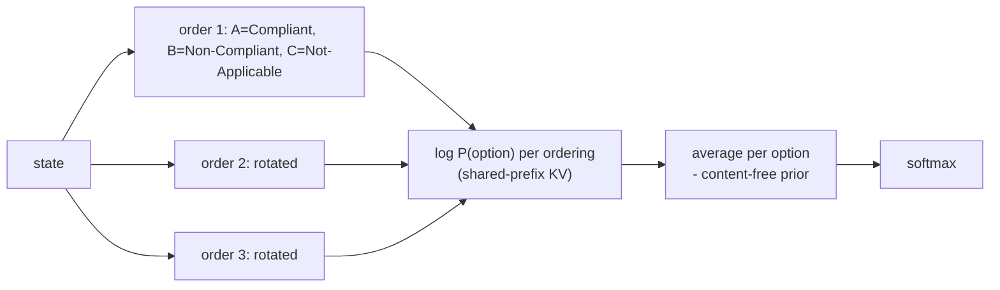

Removes two known biases of letter readouts: **position** bias (averages over cyclic orderings of
the options: 3 on ACE, 4 on BANKING77) and **label prior** bias (subtracts the content-free prior,
as in C2+, with the same `N/A` flaw on ACE).

## C7 — Early-exit question head (supervised)

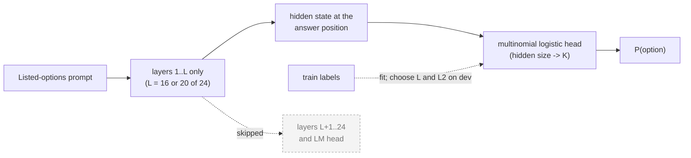

Tests whether the decision is already formed partway through the network. The forward pass is
truncated at layer L, so inference is cheaper than a full pass. L is chosen on dev from
{12, 16, 20}: 16 (ACE short), 20 (ACE verbose, BANKING77).

## C8 — Reason, then read

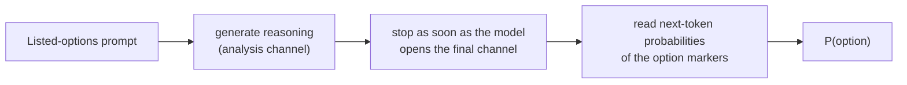

Keeps the benefit of reasoning but replaces sampling the answer with a probability readout at the
answer position. This turns a one-hot answer into a real distribution (for confidence
thresholds), and the answer can never be an invented label.

## C9 — Adaptive cascade (offline)

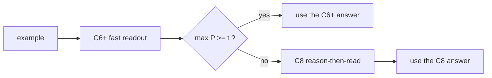

Answer quickly when the fast readout is confident; spend reasoning only on hard cases. Built from
the stored C6+ and C8 predictions by `scripts/build_cascade.py` (no new model calls). The
threshold `t` is fit on the calibration split: the lowest escalation rate whose accuracy is within
0.5 points of C8 alone. Latency and cost are C6+ plus C8 for the escalated examples.

## D2 — Unbatched sequence scoring (diagnostic)

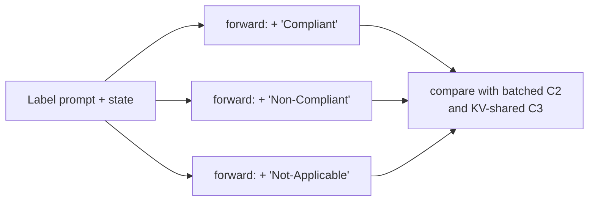

C2 with one forward pass per candidate (no batching or padding). It is not on the leaderboard;
it showed that C2 vs. C3 differences come from bf16 numerics that depend on the batch shape
(median about 0.1 nats), not from a bug.

---

# Part 3 — How do decision models work? (R-series)

Full description, hypotheses and commands: [replication.md](replication.md).

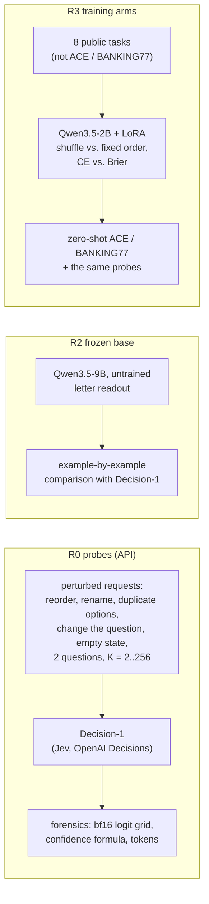

## R2 / R3 — Chat-model letter readout (`local_chat_readout`)

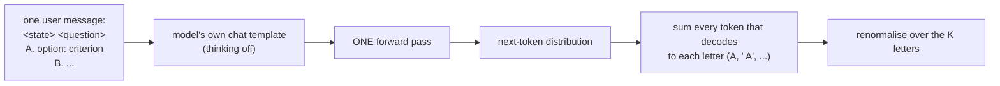

The recipe of the open "System One" replicas that read instruct models (Cygnet, SemIf, Quyet,
H2O-Lightning). Unlike C6, it uses a non-reasoning chat template (no skipped analysis channel)
and sums all token variants of each letter. More than 26 options are scored in groups, then
the group winners against each other. R3 trains a LoRA adapter on exactly this prompt and
readout.
