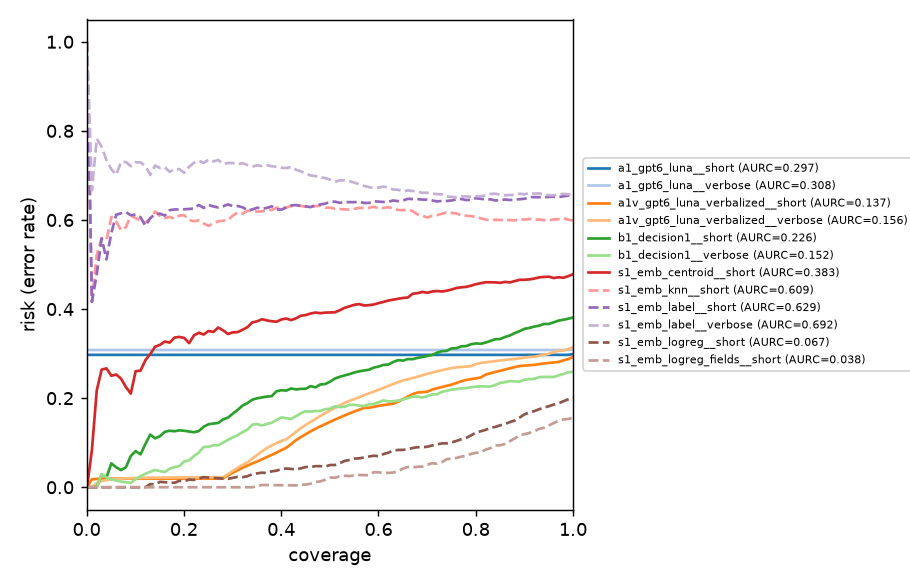

# Benchmark report: `ace` / `test`

Generated 2026-10-13T06:21:18+00:00. Temperature `T` is fit on each run's `calibration` split (never on the evaluated split); `*_cal` columns use it. Failed requests count as errors with a uniform distribution. `supervised` runs fit on the dataset's train labels; `zero_shot` runs do not.

## Product leaderboard: what works best in practice?

Evaluated on the 1100 examples shared by all runs.

| run | method | model | supervision | labels | n | err | acc | macro_f1 | nll | brier | ece | aurc | acc@80 | acc@90 | T | nll_cal | ece_cal | p50_ms | p95_ms | ttft_p50_ms | in_tok | out_tok | usd_per_1k |
|---|---|---|---|---|---|---|---|---|---|---|---|---|---|---|---|---|---|---|---|---|---|---|---|
| s1_emb_logreg_fields__short | embedding | text-embedding-3-large | supervised | short | 1100 | 0 | 0.844 | 0.850 | 0.360 | 0.216 | 0.046 | 0.038 | 0.924 | 0.882 | 1.061 | 0.356 | 0.036 | 191 | 317 | - | 722 | 0.000 | 0.094 |
| s1_emb_logreg__short | embedding | text-embedding-3-large | supervised | short | 1100 | 0 | 0.800 | 0.800 | 0.465 | 0.271 | 0.036 | 0.067 | 0.878 | 0.837 | 0.945 | 0.468 | 0.043 | 199 | 399 | - | 727 | 0.000 | 0.094 |
| b1_decision1__verbose | azure_foundry_decision | decision-1 | zero_shot | verbose | 1100 | 0 | 0.741 | 0.730 | 0.727 | 0.402 | 0.106 | 0.154 | 0.775 | 0.758 | 1.647 | 0.644 | 0.065 | 636 | 1693 | - | 859 | 1.000 | 0.036 |
| a1v_gpt6_luna_verbalized__short | azure_openai_autoregressive | gpt-6-luna | zero_shot | short | 1100 | 3 | 0.707 | 0.718 | 0.889 | 0.480 | 0.189 | 0.137 | 0.756 | 0.727 | 1.005 | 0.886 | 0.188 | 2241 | 7200 | 2024 | 864 | 263 | 0.226 |
| a1_gpt6_luna__short | azure_openai_autoregressive | gpt-6-luna | zero_shot | short | 1100 | 3 | 0.701 | 0.710 | 8.192 | 0.595 | 0.296 | 0.297 | 0.703 | 0.703 | 4.122 | 1.064 | 0.231 | 2072 | 6193 | 1892 | 801 | 215 | 0.196 |
| a1_gpt6_luna__verbose | azure_openai_autoregressive | gpt-6-luna | zero_shot | verbose | 1100 | 3 | 0.690 | 0.698 | 8.493 | 0.616 | 0.307 | 0.308 | 0.692 | 0.692 | 4.368 | 1.056 | 0.229 | 2222 | 8358 | 2042 | 863 | 295 | 0.243 |
| a1v_gpt6_luna_verbalized__verbose | azure_openai_autoregressive | gpt-6-luna | zero_shot | verbose | 1100 | 3 | 0.685 | 0.694 | 0.948 | 0.514 | 0.205 | 0.156 | 0.724 | 0.709 | 1.010 | 0.942 | 0.203 | 2716 | 8658 | 2485 | 925 | 347 | 0.276 |
| b1_decision1__short | azure_foundry_decision | decision-1 | zero_shot | short | 1100 | 0 | 0.619 | 0.527 | 1.154 | 0.582 | 0.222 | 0.242 | 0.667 | 0.639 | 2.751 | 0.836 | 0.039 | 777 | 1696 | - | 809 | 1.000 | 0.034 |
| s1_emb_centroid__short | embedding | text-embedding-3-large | supervised | short | 1100 | 0 | 0.522 | 0.520 | 1.048 | 0.632 | 0.132 | 0.392 | 0.542 | 0.536 | 0.272 | 1.036 | 0.022 | 195 | 388 | - | 727 | 0.000 | 0.094 |
| s1_emb_knn__short | embedding | text-embedding-3-large | supervised | short | 1100 | 0 | 0.401 | 0.405 | 1.283 | 0.749 | 0.204 | 0.618 | 0.398 | 0.400 | 2.271 | 1.104 | 0.089 | 198 | 400 | - | 727 | 0.000 | 0.094 |
| s1_emb_label__short | embedding | text-embedding-3-large | zero_shot | short | 1100 | 0 | 0.345 | 0.254 | 1.128 | 0.690 | 0.147 | 0.627 | 0.353 | 0.353 | 3.312 | 1.089 | 0.036 | 199 | 419 | - | 727 | 0.000 | 0.094 |
| s1_emb_label__verbose | embedding | text-embedding-3-large | zero_shot | verbose | 1100 | 0 | 0.342 | 0.279 | 1.247 | 0.758 | 0.194 | 0.692 | 0.345 | 0.341 | 7.911 | 1.101 | 0.018 | 193 | 388 | - | 727 | 0.000 | 0.094 |

**Selective prediction** (threshold fit on calibration split):

| run | target_cov | threshold | coverage | accuracy |
|---|---|---|---|---|
| a1_gpt6_luna__short | 0.800 | 0.935 | 0.997 | 0.703 |
| a1_gpt6_luna__short | 0.900 | 0.935 | 0.997 | 0.703 |
| a1_gpt6_luna__short | 0.950 | 0.935 | 0.997 | 0.703 |
| a1_gpt6_luna__verbose | 0.800 | 0.922 | 0.997 | 0.692 |
| a1_gpt6_luna__verbose | 0.900 | 0.922 | 0.997 | 0.692 |
| a1_gpt6_luna__verbose | 0.950 | 0.922 | 0.997 | 0.692 |
| a1v_gpt6_luna_verbalized__short | 0.800 | 0.909 | 0.571 | 0.822 |
| a1v_gpt6_luna_verbalized__short | 0.900 | 0.838 | 0.750 | 0.770 |
| a1v_gpt6_luna_verbalized__short | 0.950 | 0.788 | 0.820 | 0.747 |
| a1v_gpt6_luna_verbalized__verbose | 0.800 | 0.867 | 0.647 | 0.761 |
| a1v_gpt6_luna_verbalized__verbose | 0.900 | 0.817 | 0.790 | 0.728 |
| a1v_gpt6_luna_verbalized__verbose | 0.950 | 0.777 | 0.873 | 0.713 |
| b1_decision1__short | 0.800 | 0.504 | 0.782 | 0.684 |
| b1_decision1__short | 0.900 | 0.465 | 0.886 | 0.649 |
| b1_decision1__short | 0.950 | 0.432 | 0.941 | 0.633 |
| b1_decision1__verbose | 0.800 | 0.592 | 0.767 | 0.777 |
| b1_decision1__verbose | 0.900 | 0.524 | 0.879 | 0.762 |
| b1_decision1__verbose | 0.950 | 0.486 | 0.946 | 0.752 |
| s1_emb_centroid__short | 0.800 | 0.433 | 0.799 | 0.545 |
| s1_emb_centroid__short | 0.900 | 0.405 | 0.896 | 0.535 |
| s1_emb_centroid__short | 0.950 | 0.384 | 0.946 | 0.525 |
| s1_emb_knn__short | 0.800 | 0.396 | 0.816 | 0.400 |
| s1_emb_knn__short | 0.900 | 0.376 | 0.905 | 0.399 |
| s1_emb_knn__short | 0.950 | 0.362 | 0.958 | 0.398 |
| s1_emb_label__short | 0.800 | 0.360 | 0.818 | 0.353 |
| s1_emb_label__short | 0.900 | 0.352 | 0.920 | 0.349 |
| s1_emb_label__short | 0.950 | 0.347 | 0.964 | 0.348 |
| s1_emb_label__verbose | 0.800 | 0.348 | 0.799 | 0.347 |
| s1_emb_label__verbose | 0.900 | 0.344 | 0.904 | 0.342 |
| s1_emb_label__verbose | 0.950 | 0.341 | 0.960 | 0.345 |
| s1_emb_logreg__short | 0.800 | 0.715 | 0.763 | 0.896 |
| s1_emb_logreg__short | 0.900 | 0.586 | 0.881 | 0.850 |
| s1_emb_logreg__short | 0.950 | 0.523 | 0.940 | 0.821 |
| s1_emb_logreg_fields__short | 0.800 | 0.807 | 0.744 | 0.936 |
| s1_emb_logreg_fields__short | 0.900 | 0.682 | 0.848 | 0.906 |
| s1_emb_logreg_fields__short | 0.950 | 0.597 | 0.909 | 0.878 |

## Controlled readout leaderboard: same model (gpt-oss-20b), different decision mechanism

_No runs yet._
