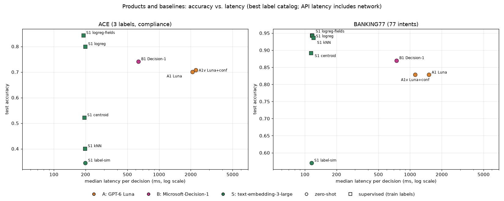
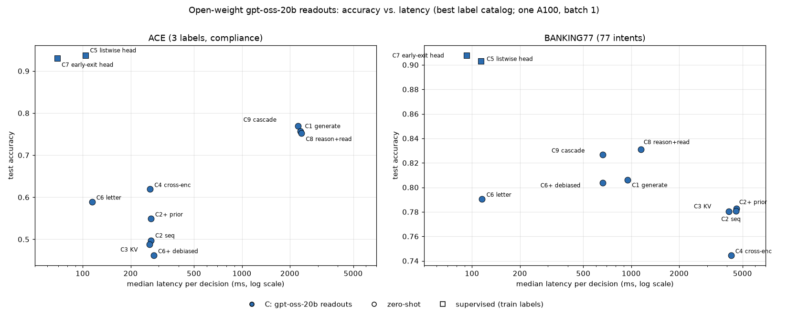
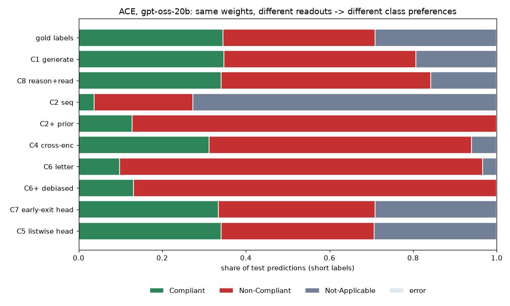

# C-series readouts on gpt-oss-20b, plus BANKING77 (2026-10-14)

This is the second results snapshot. It adds every C-series readout on `openai/gpt-oss-20b`
(C1–C9) and reruns the API and embedding methods on a second dataset, BANKING77 (77 intents).
The first snapshot ([ACE baseline](../2026-10-13-ace-baseline/README.md)) covered the API
methods and embeddings on ACE; those ACE numbers are unchanged.

How each method works, with a diagram per experiment: [docs/methods.md](../../methods.md).

**The results come in two separate parts, and they are never ranked against each other.**

| | Part 1: products and baselines | Part 2: open-weight model |
|---|---|---|
| Experiments | A1/A1v (GPT-6 Luna), B1 (Microsoft-Decision-1), S1 (`text-embedding-3-large`) | C1–C9 on `openai/gpt-oss-20b` |
| What we control | Only the request (prompt, options); hosted models and weights are opaque | Everything: weights, prompt, and how the answer is read out |
| Question | Which product works best for bounded decisions? | Holding the model fixed, what does changing the readout buy? |
| Generated leaderboard | `product` | `controlled` |

The two parts use different models (size, training, serving stack, hardware, network), so
comparing a C-series number with a Part 1 number says nothing about the decision mechanism.

## Setup (both parts)

| | ACE | BANKING77 |
|---|---|---|
| Task | Is the scenario compliant with the contract clauses? | Which banking support intent matches the message? |
| Options | 3 (`Compliant`, `Non-Compliant`, `Not-Applicable`) | 77 intents, raw identifiers (e.g. `card_arrival`) |
| Label catalogs | `short` (names) and `verbose` (names + criteria) | `short` only (no descriptions) |
| Splits (train / dev / calibration / test) | 2,161 / 719 / 720 / 1,100 (official test) | 6,002 / 2,001 / 2,000 / 3,080 (official test) |
| Distribution shift calibration → test | strong (see the [ACE baseline](../2026-10-13-ace-baseline/README.md)) | none (calibration ≈ test accuracy) |

- **Calibration:** temperature scaling and selective-prediction thresholds are fit on the
  `calibration` split and applied unchanged to test.
- **Supervised vs. zero-shot:** `supervised` runs fit parameters on the train split (S1
  centroid/kNN/logreg in Part 1; C5, C7 in Part 2). Everything else uses no labels (C9 only fits a
  threshold on calibration). Compare supervised runs with each other, not with zero-shot runs.
- **Generated reports:** [ace/report-test.md](ace/report-test.md) and
  [banking77/report-test.md](banking77/report-test.md), with CSVs, reliability diagrams and
  risk-coverage curves in the same folders. Each report has one section per part.

Column guide:
- **Acc** — test accuracy.
- **NLL / ECE** — log-loss and expected calibration error; "cal" means after temperature
  scaling.
- **AURC** — area under the risk-coverage curve. It measures how well confidence ranks right
  above wrong answers; lower is better.
- **Acc @ 80%** — test accuracy of the most confident 80% of decisions.
- **p50** — median latency per decision.
- **$/1k** — cost per 1,000 decisions.

---

# Part 1 — Products and baselines (A, B, S)

GPT-6 Luna (Azure OpenAI Responses API, reasoning `medium`), Microsoft-Decision-1 (Azure AI
Foundry) and `text-embedding-3-large`, all called as hosted APIs. Latencies are measured from a
laptop and include network time; costs are list prices. The OpenAI Decisions API (A2, the
decision API on GPT-6 Luna) is still unavailable on Azure.

## Part 1 TL;DR

1. **Decision-1 is the best zero-shot product on both datasets:**
   - **ACE:** 0.741 with criteria text, vs. 0.70–0.71 for GPT-6 Luna.
   - **BANKING77:** 0.870 vs. 0.829.
   - It is also faster and cheaper than GPT-6 Luna: 0.6–0.8 s and $0.03 per 1k decisions.
2. **Decision-1 returns usable probabilities out of the box.** On BANKING77 its ECE is 0.015
   with a fitted temperature of ≈ 1.0, so no recalibration is needed. Its most confident 82% are
   93.6% accurate.
3. **GPT-6 Luna's label-only answers can't support a confidence policy.** Every answer is "100%
   sure". Asking for a verbalized confidence (A1v) helps: on BANKING77 the most confident 83%
   are 88.8% accurate, and AURC drops from 0.171 to 0.061.
4. **Decision-1 needs criteria text on ACE.**
   - With label names only, it scores 0.62 and almost never predicts `Not-Applicable`
     (recall 0.10).
   - With descriptions, it scores 0.74 and that recall rises to 0.52.
5. **With a few thousand labelled examples, embeddings + logistic regression win.**
   - BANKING77: 0.944 at $0.002 per 1k decisions.
   - ACE: 0.844. ACE's scenario text partly gives away the label.



## Part 1 accuracy at a glance (test)

| Method | Supervision | ACE short | ACE verbose | BANKING77 |
|---|---|---|---|---|
| A1 GPT-6 Luna, label only | zero-shot | 0.701 | 0.690 | 0.829 |
| A1v GPT-6 Luna, verbalized confidence | zero-shot | **0.707** | 0.685 | 0.829 |
| B1 Microsoft-Decision-1 | zero-shot | 0.619 | **0.741** | **0.870** |
| S1 embedding label similarity | zero-shot | 0.345 | 0.342 | 0.570 |
| S1 embedding centroid | supervised | 0.522 | – | 0.892 |
| S1 embedding kNN | supervised | 0.401 | – | 0.936 |
| S1 embedding logreg | supervised | 0.800 | – | 0.943 |
| S1 embedding logreg, per field | supervised | **0.844** | – | **0.944** |

Bold: best zero-shot and best supervised per column. Six GPT-6 Luna ACE answers (3 per variant)
ran out of output tokens and count as errors.

## Part 1 leaderboards

### ACE

| Run | Supervision | Acc | Macro-F1 | NLL raw → cal | ECE raw → cal | AURC | Acc @ 80% | p50 | $/1k |
|---|---|---|---|---|---|---|---|---|---|
| S1 embedding logreg, per field | supervised | 0.844 | 0.850 | 0.360 → 0.356 | 0.046 → 0.036 | 0.038 | 0.924 | 191 ms | 0.094 |
| S1 embedding logreg | supervised | 0.800 | 0.800 | 0.465 → 0.468 | 0.036 → 0.043 | 0.067 | 0.878 | 199 ms | 0.094 |
| B1 Decision-1, verbose | zero-shot | 0.741 | 0.730 | 0.727 → 0.644 | 0.106 → 0.065 | 0.154 | 0.775 | 636 ms | 0.036 |
| A1v GPT-6 Luna verbalized, short | zero-shot | 0.707 | 0.718 | 0.889 → 0.886 | 0.189 → 0.188 | 0.137 | 0.756 | 2.2 s | 0.226 |
| A1 GPT-6 Luna, short | zero-shot | 0.701 | 0.710 | 8.19 → 1.06 | 0.296 → 0.231 | 0.297 | 0.703 | 2.1 s | 0.196 |
| A1 GPT-6 Luna, verbose | zero-shot | 0.690 | 0.698 | 8.49 → 1.06 | 0.307 → 0.229 | 0.308 | 0.692 | 2.2 s | 0.243 |
| A1v GPT-6 Luna verbalized, verbose | zero-shot | 0.685 | 0.694 | 0.948 → 0.942 | 0.205 → 0.203 | 0.156 | 0.724 | 2.7 s | 0.276 |
| B1 Decision-1, short | zero-shot | 0.619 | 0.527 | 1.154 → 0.836 | 0.222 → 0.039 | 0.242 | 0.667 | 777 ms | 0.034 |
| S1 embedding centroid | supervised | 0.522 | 0.520 | 1.048 → 1.036 | 0.132 → 0.022 | 0.392 | 0.542 | 195 ms | 0.094 |
| S1 embedding kNN | supervised | 0.401 | 0.405 | 1.283 → 1.104 | 0.204 → 0.089 | 0.618 | 0.398 | 198 ms | 0.094 |
| S1 label similarity, short | zero-shot | 0.345 | 0.254 | 1.128 → 1.089 | 0.147 → 0.036 | 0.627 | 0.353 | 199 ms | 0.094 |
| S1 label similarity, verbose | zero-shot | 0.342 | 0.279 | 1.247 → 1.101 | 0.194 → 0.018 | 0.692 | 0.345 | 193 ms | 0.094 |

### BANKING77

| Run | Supervision | Acc | Macro-F1 | NLL raw → cal | ECE raw → cal | AURC | Acc @ 80% | p50 | $/1k |
|---|---|---|---|---|---|---|---|---|---|
| S1 embedding logreg, message only | supervised | 0.944 | 0.944 | 0.212 → 0.212 | 0.012 → 0.013 | 0.009 | 0.990 | 117 ms | 0.002 |
| S1 embedding logreg, full state | supervised | 0.943 | 0.943 | 0.214 → 0.214 | 0.015 → 0.014 | 0.008 | 0.988 | 117 ms | 0.002 |
| S1 embedding kNN | supervised | 0.936 | 0.937 | 0.264 → 0.243 | 0.062 → 0.031 | 0.010 | 0.988 | 120 ms | 0.002 |
| S1 embedding centroid | supervised | 0.892 | 0.892 | 0.669 → 0.356 | 0.284 → 0.017 | 0.021 | 0.963 | 114 ms | 0.002 |
| B1 Decision-1 | zero-shot | 0.870 | 0.867 | 0.492 → 0.492 | 0.015 → 0.014 | 0.031 | 0.944 | 744 ms | 0.034 |
| A1 GPT-6 Luna, label only | zero-shot | 0.829 | 0.823 | 4.73 → 1.20 | 0.171 → 0.025 | 0.171 | 0.829 | 1.5 s | 0.083 |
| A1v GPT-6 Luna, verbalized | zero-shot | 0.829 | 0.823 | 1.15 → 1.11 | 0.078 → 0.024 | 0.061 | 0.894 | 1.1 s | 0.139 |
| S1 embedding label similarity | zero-shot | 0.570 | 0.547 | 1.71 → 1.62 | 0.144 → 0.030 | 0.195 | 0.653 | 115 ms | 0.002 |

`logreg_fields` on BANKING77 embeds the message field alone, without the `Customer message:`
template; `logreg` embeds the rendered state.

### Selective prediction (Part 1)

Thresholds are fit on calibration for 80% coverage, then applied to test. Each cell shows test
coverage → accuracy.

| Run | ACE | BANKING77 |
|---|---|---|
| S1 embedding logreg † | 0.74 → 0.936 (per field) | 0.80 → 0.990 (message only) |
| B1 Decision-1 | 0.77 → 0.777 (verbose) | 0.82 → 0.936 |
| A1v GPT-6 Luna, verbalized | 0.57 → 0.822 (short) | 0.83 → 0.888 |
| A1 GPT-6 Luna, label only | 1.00 → 0.703 (cannot abstain) | 1.00 → 0.829 (cannot abstain) |

† supervised. On ACE, every method automates less than the 80% target on test, because of the
calibration → test shift.

## Part 1 findings

1. **Decision-1 (H1).**
   - **Accuracy:** it is the most accurate zero-shot product on both datasets.
   - **Probabilities:** they are the best behaved:
     - BANKING77 needs no temperature correction (T ≈ 1.0, ECE 0.015).
     - On ACE, temperature scaling brings ECE from 0.106 to 0.065.
   - **Speed and cost:** it is 1.5–4× faster and 2.4–7.7× cheaper per decision than GPT-6
     Luna.
   - **Caveat:** it relies on the option descriptions (finding 3).
2. **GPT-6 Luna.**
   - **Label only:** answers are one-hot, so raw NLL is dominated by confident errors (4.7 on
     BANKING77, 8.2 on ACE) and the model cannot abstain.
   - **Verbalized confidence:** costs 20–40% more output tokens and makes selective
     prediction possible. Its calibration does not survive the ACE shift: ECE stays at 0.19
     after temperature scaling.
   - **Criteria text:** verbose descriptions slightly hurt GPT-6 Luna on ACE (−1 to −2 points).
3. **Criteria text matters for Decision-1 (H3).** On ACE, descriptions add 12 points
   (0.62 → 0.74). With short labels it over-predicts `Non-Compliant` (64% of answers; recall
   0.98) and rarely says `Not-Applicable` (recall 0.10). BANKING77 has no descriptions, so we
   can't test this there.
4. **Embeddings are a strong supervised baseline and a weak zero-shot one.**
   - **Supervised:** on BANKING77, a lexical/semantic task with 6k training examples, logistic
     regression on embeddings is the most accurate and best-calibrated method in Part 1.
   - **Zero-shot:** cosine similarity to label names alone is weak (0.57 on BANKING77, near
     chance on ACE).
   - **ACE caveat:** the supervised probes partly exploit the scenario-text shortcut documented
     in the ACE baseline.

---

# Part 2 — Open-weight model: gpt-oss-20b readouts (C-series)

Every C experiment uses the same weights (`openai/gpt-oss-20b`, dequantized to bf16) on one
A100 80 GB (`Standard_NC24ads_A100_v4`, Azure ML low-priority). They use the same harmony
prompt conventions with reasoning effort `low`, greedy decoding, batch size 1 and concurrency 1.
Only the readout changes: how the question is posed and how the answer is extracted.

- **Latency** is GPU time per decision.
- **Cost** is GPU seconds × $4.775/h (on-demand A100). Local runs are unoptimised (plain
  `transformers`, no serving engine), so absolute numbers are upper bounds; relative numbers
  within the C-series are fair.
- **Compute:** about 37 GPU-hours of inference across 30 cluster jobs, up to 5 in parallel.
  Pre-empted jobs resumed from synced output.

## Part 2 TL;DR

1. **The decision is already in the hidden states.**
   - A linear head trained on frozen activations scores 0.937 (C5) and 0.931 (C7) on ACE, and
     0.903 / 0.908 on BANKING77.
   - C7 runs only the first 16–20 of 24 layers (69–93 ms per decision).
   - These heads are *supervised*: they are trained on the dataset's train labels.
2. **Zero-shot single-pass readouts work for "intuitive" decisions and fail for deliberative
   ones.**
   - **BANKING77:** reading the option letter from one forward pass (C6, 116 ms) is within 1.5
     points of generating with reasoning (C1, 949 ms), with much better confidence ranking.
   - **ACE:** the same readouts score 0.45–0.62, against 0.69–0.77 for readouts that reason
     first.
3. **The readout format, not the model, decides what a zero-shot readout prefers.** On ACE, the
   same weights predict `Not-Applicable` for 73% of examples with sequence scoring (C2) and
   `Non-Compliant` for 87% with letter readout (C6). Generation (C1) and the trained heads match
   the true label mix.
4. **Reasoning first, then reading probabilities (C8), matches generation's accuracy and gives
   usable confidence.**
   - On ACE (verbose), AURC is 0.130 vs. 0.243 for C1.
   - The answer can never be an invented label; C1 invented 30 labels on BANKING77.
5. **Our debiasing (C2+, C6+) has a design flaw on ACE.** The "content-free" input `N/A` reads
   as "not applicable", so the correction erases the `Not-Applicable` class. It needs a rerun
   with a neutral input.



## Part 2 accuracy at a glance (test)

| Readout | Supervision | ACE short | ACE verbose | BANKING77 |
|---|---|---|---|---|
| C1 generate | zero-shot | **0.743** | 0.757 | 0.806 |
| C2 sequence likelihood | zero-shot | 0.472 | 0.497 | 0.781 |
| C3 sequence likelihood, shared KV | zero-shot | 0.473 | 0.488 | 0.781 |
| C2+ sequence likelihood + prior | zero-shot | 0.465 | 0.549 | 0.783 |
| C4 cross-encoder Yes/No | zero-shot | 0.619 | 0.596 | 0.744 |
| C6 letter readout, one pass | zero-shot | 0.471 | 0.589 | 0.791 |
| C6+ letter readout, debiased | zero-shot | 0.462 | 0.445 | 0.804 |
| C8 reason, then read | zero-shot | 0.686 | 0.753 | **0.831** |
| C9 cascade C6+ → C8 | zero-shot | 0.691 | **0.769** | 0.827 |
| C5 listwise head | supervised | **0.937** | 0.924 | 0.903 |
| C7 early-exit head | supervised | 0.931 | **0.928** | **0.908** |

Bold: best zero-shot and best supervised per column.

## Part 2 leaderboards

### ACE

| Run | Acc | Macro-F1 | NLL (cal) | ECE (cal) | AURC | Acc @ 80% | p50 | Input tokens | $/1k |
|---|---|---|---|---|---|---|---|---|---|
| C5 listwise head, short † | 0.937 | 0.939 | 0.199 | 0.032 | 0.010 | 0.982 | 104 ms | 863 | 0.20 |
| C7 early-exit head (L16), short † | 0.931 | 0.933 | 0.168 | 0.015 | 0.009 | 0.988 | 69 ms | 870 | 0.13 |
| C7 early-exit head (L20), verbose † | 0.928 | 0.931 | 0.222 | 0.037 | 0.011 | 0.981 | 93 ms | 933 | 0.18 |
| C5 listwise head, verbose † | 0.924 | 0.925 | 0.204 | 0.026 | 0.012 | 0.976 | 113 ms | 928 | 0.22 |
| C9 cascade, verbose | 0.769 | 0.777 | 0.739 | 0.112 | 0.166 | 0.743 | 2.3 s | 1,819 | 3.29 |
| C1 generate, verbose | 0.757 | 0.767 | 0.793 | 0.133 | 0.243 | 0.757 | 2.3 s | 930 | 3.70 |
| C8 reason then read, verbose | 0.753 | 0.763 | 0.778 | 0.116 | 0.130 | 0.793 | 2.4 s | 930 | 3.75 |
| C1 generate, short | 0.743 | 0.745 | 0.768 | 0.079 | 0.257 | 0.743 | 2.2 s | 868 | 3.43 |
| C9 cascade, short | 0.691 | 0.689 | 0.855 | 0.089 | 0.252 | 0.673 | 2.4 s | 1,637 | 3.38 |
| C8 reason then read, short | 0.686 | 0.686 | 0.863 | 0.099 | 0.217 | 0.702 | 2.3 s | 867 | 3.47 |
| C4 cross-encoder, short | 0.619 | 0.554 | 0.819 | 0.041 | 0.260 | 0.666 | 265 ms | 889 | 0.41 |
| C4 cross-encoder, verbose | 0.596 | 0.544 | 0.816 | 0.061 | 0.256 | 0.642 | 288 ms | 954 | 0.44 |
| C6 letter readout, verbose | 0.589 | 0.530 | 0.888 | 0.073 | 0.243 | 0.637 | 114 ms | 933 | 0.22 |
| C2+ sequence + prior, verbose | 0.549 | 0.430 | 0.931 | 0.100 | 0.286 | 0.593 | 268 ms | 2,811 | 0.55 |
| C2 sequence, verbose | 0.497 | 0.459 | 1.017 | 0.143 | 0.322 | 0.524 | 268 ms | 2,811 | 0.55 |
| C3 sequence KV, verbose | 0.488 | 0.450 | 1.015 | 0.158 | 0.317 | 0.532 | 263 ms | 944 | 0.41 |
| C3 sequence KV, short | 0.473 | 0.430 | 1.048 | 0.151 | 0.356 | 0.500 | 253 ms | 882 | 0.40 |
| C2 sequence, short | 0.472 | 0.427 | 1.046 | 0.147 | 0.358 | 0.501 | 243 ms | 2,625 | 0.51 |
| C6 letter readout, short | 0.471 | 0.373 | 0.964 | 0.140 | 0.340 | 0.500 | 106 ms | 870 | 0.20 |
| C2+ sequence + prior, short | 0.465 | 0.339 | 0.986 | 0.152 | 0.343 | 0.497 | 238 ms | 2,625 | 0.50 |
| C6+ letter debiased, short | 0.462 | 0.335 | 1.004 | 0.147 | 0.350 | 0.497 | 279 ms | 916 | 0.43 |
| C6+ letter debiased, verbose | 0.445 | 0.343 | 0.944 | 0.201 | 0.321 | 0.486 | 316 ms | 1,105 | 0.48 |

† supervised (trained on ACE train labels).

### BANKING77

| Run | Acc | Macro-F1 | NLL (cal) | ECE (cal) | AURC | Acc @ 80% | p50 | Input tokens | $/1k |
|---|---|---|---|---|---|---|---|---|---|
| C7 early-exit head (L20) † | 0.908 | 0.907 | 0.347 | 0.014 | 0.015 | 0.974 | 93 ms | 749 | 0.12 |
| C5 listwise head (L24) † | 0.903 | 0.903 | 0.328 | 0.016 | 0.017 | 0.974 | 114 ms | 723 | 0.15 |
| C8 reason then read | 0.831 | 0.825 | 1.182 | 0.016 | 0.134 | 0.850 | 1.1 s | 746 | 1.75 |
| C9 cascade (22% escalated) | 0.827 | 0.820 | 1.118 | 0.011 | 0.201 | 0.852 | 662 ms | 2,783 | 1.42 |
| C1 generate | 0.806 | 0.803 | 1.317 | 0.026 | 0.186 | 0.814 | 949 ms | 596 | 1.76 |
| C6+ letter debiased | 0.804 | 0.797 | 0.917 | 0.050 | 0.060 | 0.889 | 660 ms | 2,621 | 0.88 |
| C6 letter readout | 0.791 | 0.784 | 0.990 | 0.038 | 0.078 | 0.875 | 116 ms | 749 | 0.15 |
| C2+ sequence + prior | 0.783 | 0.777 | 0.940 | 0.037 | 0.068 | 0.871 | 4.6 s | 46,549 | 6.08 |
| C2 sequence | 0.781 | 0.774 | 0.952 | 0.030 | 0.068 | 0.873 | 4.5 s | 46,549 | 6.05 |
| C3 sequence KV | 0.781 | 0.773 | 0.952 | 0.031 | 0.069 | 0.872 | 4.1 s | 998 | 5.49 |
| C4 cross-encoder | 0.744 | 0.743 | 0.954 | 0.057 | 0.099 | 0.830 | 4.2 s | 925 | 5.64 |

† supervised (trained on BANKING77 train labels).

### Selective prediction (Part 2)

Thresholds are fit on calibration for 80% coverage, then applied to test. Each cell shows test
coverage → accuracy.

| Run | ACE | BANKING77 |
|---|---|---|
| C7 early-exit head † | 0.69 → 0.990 (short) | 0.80 → 0.974 |
| C5 listwise head † | 0.68 → 0.991 (short) | 0.80 → 0.974 |
| C8 reason then read | 0.75 → 0.804 (verbose) | 0.79 → 0.850 |
| C6+ letter debiased | – | 0.80 → 0.893 |
| C6 letter readout | – | 0.81 → 0.872 |
| C1 generate (one-hot) | 1.00 → 0.757 (cannot abstain) | 0.99 → 0.814 (cannot abstain) |

† supervised.



## Part 2 findings

### 1. A linear head on frozen hidden states is the strongest readout (H5)

- **Accuracy and calibration.** C5 and C7 reach 0.92–0.94 on ACE and 0.90–0.91 on BANKING77,
  well calibrated even before temperature scaling (raw ECE 0.014–0.031). Their confidence is the
  best for selective prediction: about 0.99 accuracy on the 68–69% of ACE test cases they are
  most sure about.
- **Mid-depth layers suffice.** Dev selection picked layer 16 of 24 for C5 on ACE (24 on
  BANKING77) and layers 16–20 for C7. C7 stops the forward pass there, so it is also the
  fastest readout (69 ms on ACE).
- **What it is and isn't.** The base model is never fine-tuned: only a vector (C5) or a single
  matrix (C7) is fit on 2k–6k labelled examples.
- **Caveat.** The heads see train labels and learn the dataset's labelling conventions, which
  the zero-shot readouts cannot. Compare them with each other, not with zero-shot readouts as
  equals.

### 2. Single-pass zero-shot readouts: good for intuitive decisions, poor for deliberative ones

On BANKING77, the cheapest zero-shot readout (C6: list the options, read the letter
distribution from one forward pass) gives up 1.5 points of accuracy against generation with
reasoning (C1), and is better on every other axis:

| BANKING77 | C6 letter readout | C1 generate |
|---|---|---|
| Accuracy | 0.791 | 0.806 |
| Median latency | 116 ms | 949 ms |
| AURC (lower is better) | 0.078 | 0.186 |
| Accuracy on the most confident 80% | 0.875 | 0.814 (cannot abstain) |
| Invalid / invented labels | 0 | 30 (1.0%) |
| $/1k (A100 time) | 0.15 | 1.76 |

**ACE: reasoning matters.**
- Every zero-shot readout without reasoning (C2, C3, C2+, C4, C6, C6+) scores 0.45–0.62.
- The readouts that reason first (C1, C8, C9) score 0.69–0.77.
- This is not the distribution shift: the same gap exists on the train-derived calibration
  split (C6 short 0.48 vs. C1 short 0.82).

ACE decisions require applying conditions, exceptions and timing rules across several clauses.
The model needs its reasoning tokens to do that, and a single forward pass at the answer
position cannot replace them zero-shot. Yet the same forward pass *does* contain the answer
once a head is trained on it (finding 1). The information is there, but the untrained readout
cannot extract it.

### 3. Zero-shot readouts carry strong, format-specific class biases

See the prediction-mix chart above (ACE, short labels; gold mix 35% / 36% / 29%):

| Readout | Most-predicted class | Share of predictions |
|---|---|---|
| C2 / C3 sequence likelihood | `Not-Applicable` | 73% |
| C6 letter readout | `Non-Compliant` | 87% |
| C4 cross-encoder Yes/No | `Non-Compliant` | 63% |
| C1, C8 (reason first) and C5/C7 (trained heads) | close to the gold mix | – |

Each readout introduces its own bias:
- **Sequence likelihood** favours whichever label string is most likely as a continuation.
- **Letter readout** has position and letter priors.
- **Yes/No judging** sees each candidate in isolation.

Verbose criteria reduce the bias for C6 (0.47 → 0.59) and C2 (0.47 → 0.50) but do not remove
it.

### 4. The content-free prior (C2+, C6+) needs a neutral input

C2+ and C6+ subtract the label distribution the model produces for a content-free state, `N/A`
(contextual calibration).

**ACE:** `N/A` is read as "not applicable".
- The prior gives `Not-Applicable` probability ≈ 0.98 (log-prob −0.02 vs. −8 for the others).
- The correction therefore removes that class: `Not-Applicable` recall drops from 0.90 (C2) to
  0.00 (C2+), and to 0.003 for C6+ short.

**BANKING77:** with no such collision, the corrections help slightly.
- C2+ is +0.2 points over C2.
- C6+ is +1.3 points over C6. Averaging over 4 option orderings changes the top answer for 7%
  of examples.
- C6+ costs 4 forward passes (660 ms vs. 116 ms).

**Next step:** use neutral content-free inputs (empty string, random placeholders) or the mean
prediction over unlabelled train states, then rerun C2+/C6+ on ACE.

### 5. Reason, then read (C8) beats generation on confidence, at equal accuracy (H2)

C8 runs the same reasoning as C1, but reads the option-marker distribution instead of sampling
the answer.

| | ACE verbose: C8 | ACE verbose: C1 | BANKING77: C8 | BANKING77: C1 |
|---|---|---|---|---|
| Accuracy | 0.753 | 0.757 | 0.831 | 0.806 |
| AURC (lower is better) | **0.130** | 0.243 | **0.134** | 0.186 |
| Accuracy on the most confident 80% | 0.793 | 0.757 | 0.850 | 0.814 |
| Invented labels | 0 | 0 | 0 | 30 |

- **After reasoning, the answer is near-certain.** Raw NLL is 4–6, and calibrating it needs
  temperatures of 2.4–7. Reasoning collapses uncertainty, but the probability left over still
  ranks errors much better than a one-hot answer.
- **Scoring without reasoning (C2/C3)** also ranks errors much better than C1 on BANKING77
  (AURC 0.068 vs. 0.186), with similar ECE after temperature scaling (0.030 vs. 0.026). On ACE
  it is far less accurate.
- **So H2 holds for confidence ranking**, but not for accuracy on deliberative tasks.

### 6. The cascade (C9) saves compute only when the fast stage is good enough

- **BANKING77:** the C6+ → C8 cascade escalates 22% of examples. It keeps C8's accuracy
  (0.827 vs. 0.831) at 58% of its median latency (662 ms vs. 1,148 ms) and 81% of its cost.
- **ACE:** the fast readout is weak, so the threshold escalates 72–78% of calibration and
  79–85% of test examples, and there is no saving.

Using C6 (116 ms) instead of C6+ as the fast stage would roughly halve the BANKING77 cascade
latency. That variant is untested.

### 7. Shared-prefix KV reuse gives the same answers; the saving depends on where the work is (H4)

- **Same answers.** C3 matches C2 within bf16 noise (ACE 0.473 vs. 0.472 short; BANKING77
  0.781 vs. 0.781). The D2 diagnostic attributed the remaining differences to batch-shape
  numerics.
- **Small latency saving.** KV reuse cuts input tokens 47× on BANKING77 (998 vs. 46,549), but
  latency only by 10% (4.1 s vs. 4.5 s). With 77 candidates, the per-candidate continuation
  passes dominate, not the shared prompt.
- **Listing the options once and reading a single token (C6)** is 35–39× faster than either.

### 8. Verbose criteria help readouts that read the option list (H3)

On ACE, criteria text helps the readouts that read or reason over the option list:

| Readout | Short → verbose |
|---|---|
| C6 | +11.8 points |
| C2+ | +8.4 points |
| C9 | +7.8 points |
| C8 | +6.7 points |
| C2 | +2.5 points |
| C1 | +1.4 points |

It hurts C6+ (−1.7) and C4 (−2.3), and slightly hurts the trained heads (C5 −1.3, C7 −0.3).

---

## Hypotheses status

| Hypothesis | Part | Status after this round |
|---|---|---|
| H1 Decision APIs improve calibration without losing accuracy | 1 | Supported for Decision-1 vs. GPT-6 Luna on both datasets. A2 (OpenAI Decisions on the same GPT-6 Luna weights) is still blocked on Azure, so the cleanest same-model test is pending. |
| H2 Candidate scoring beats generation on calibration (same model) | 2 | Supported for confidence ranking (C2/C3/C6 AURC 0.07–0.08 vs. 0.19 for C1 on BANKING77; C8 vs. C1 on both datasets). Not supported for accuracy on ACE without reasoning. |
| H3 Verbose criteria beat short labels | 1, 2 | Part 1: supported for Decision-1 (+12 points), not for GPT-6 Luna. Part 2: supported for readouts over listed options (C6, C8, C9), not for the trained heads. |
| H4 KV reuse equals independent scoring, faster | 2 | Equal predictions: supported. Faster: only marginally (10%) when there are many short candidates. |
| H5 A lightweight head closes the gap to purpose-built decision models | 2 | Within the open model, a linear head on frozen states is by far the best readout (0.93 ACE, 0.91 BANKING77). Not compared directly with Decision-1: different base models. |
| H6 Calibrated confidence enables selective prediction | 1, 2 | Supported in both parts (e.g. Decision-1 0.936 and C7 0.974 accuracy at ~80% coverage on BANKING77). Thresholds fit on ACE calibration under-automate on the shifted test set (57–77% instead of 80%). |
| New: the readout, not the representation, limits zero-shot decisions | 2 | Supported on ACE: the same activations give 0.47 (zero-shot letter readout) or 0.93 (trained head). |
| New: one-pass readouts suffice for intuitive decisions, not deliberative ones | 2 | Supported by the BANKING77 vs. ACE contrast. Needs a third dataset to separate "needs reasoning" from other ACE quirks. |

## Caveats

- **ACE test ≠ train distribution.** Supervised heads and calibration thresholds are fit on
  train-derived splits; see the ACE baseline for the shift and the scenario-text shortcut.
  BANKING77 has no such shift.
- **One run per configuration.** Greedy decoding is deterministic up to bf16 batch-shape noise
  (about 0.1 nats; it moved C3 vs. C2 by up to 0.9 points on ACE verbose).
- **BANKING77 has only the short catalog** (raw intent identifiers, no descriptions).
  Decision-1 and the zero-shot readouts might gain from descriptions as they did on ACE.
- **Latency is not comparable across parts.**
  - Part 1 latencies include internet round-trips from a laptop.
  - Part 2 latencies are local GPU time at batch 1 without a serving engine.
- **Debiasing:** the C2+/C6+ conclusions on ACE are invalid until rerun with a neutral prior.
- **C9 is offline:** it is computed from stored C6+ and C8 predictions. Its latency is the sum
  of stored latencies, not a measured end-to-end pipeline.

## Reproduce

```powershell
# Part 1: API + embedding runs (local)
uv run python scripts/run_experiment.py --dataset banking77 --experiment a1_gpt6_luna a1v_gpt6_luna_verbalized b1_decision1 s1_emb_label s1_emb_centroid s1_emb_knn s1_emb_logreg s1_emb_logreg_fields --split calibration test --allow-test

# Part 2: GPU runs (Azure ML), one job per experiment x catalog
uv run --extra aml python scripts/aml_submit.py --dataset ace --experiment c1_oss_autoregressive c2_oss_sequence_scoring c3_oss_kv_scoring c2p_oss_sequence_prior c4_oss_cross_encoder c5_oss_listwise_head c6_oss_letter_readout c6p_oss_letter_debiased c7_oss_early_exit_head c8_oss_reason_then_read --split calibration test --allow-test --tag main --parallel
uv run --extra aml python scripts/aml_submit.py --dataset banking77 --experiment <same list> --split calibration test --allow-test --tag main --parallel
uv run --extra aml python scripts/aml_collect.py --tag main --wait
uv run python scripts/build_cascade.py --dataset banking77 --fast c6p_oss_letter_debiased --slow c8_oss_reason_then_read

# reports (one section per part)
uv run python scripts/build_report.py --dataset banking77 --split test
```
