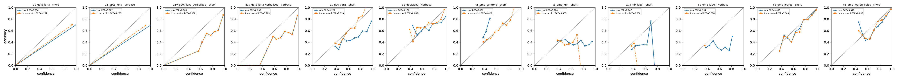
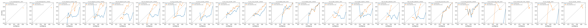
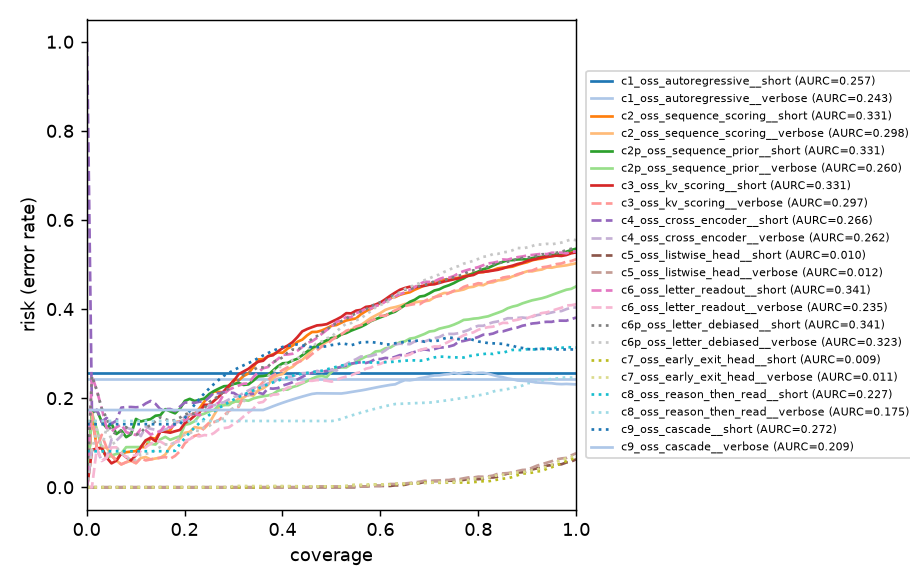

# Benchmark report: `ace` / `test`

Generated 2026-10-16T09:04:17+00:00. Temperature `T` is fit on each run's `calibration` split (never on the evaluated split); `*_cal` columns use it. Failed requests count as errors with a uniform distribution. `supervised` runs fit on the dataset's train labels; `zero_shot` runs do not.

## Products and baselines: GPT-6 Luna, Decision-1, embeddings (A / B / S)

Evaluated on the 1100 examples shared by all runs.

| run | method | model | supervision | labels | n | err | acc | macro_f1 | nll | brier | ece | aurc | acc@80 | acc@90 | T | nll_cal | ece_cal | p50_ms | p95_ms | ttft_p50_ms | in_tok | out_tok | usd_per_1k |
|---|---|---|---|---|---|---|---|---|---|---|---|---|---|---|---|---|---|---|---|---|---|---|---|
| s1_emb_logreg_fields__short | embedding | text-embedding-3-large | supervised | short | 1100 | 0 | 0.844 | 0.850 | 0.360 | 0.216 | 0.046 | 0.038 | 0.924 | 0.882 | 1.061 | 0.356 | 0.036 | 191 | 317 | - | 722 | 0.000 | 0.094 |
| s1_emb_logreg__short | embedding | text-embedding-3-large | supervised | short | 1100 | 0 | 0.800 | 0.800 | 0.465 | 0.271 | 0.036 | 0.067 | 0.878 | 0.837 | 0.945 | 0.468 | 0.043 | 199 | 399 | - | 727 | 0.000 | 0.094 |
| b1_decision1__verbose | azure_foundry_decision | decision-1 | zero_shot | verbose | 1100 | 0 | 0.741 | 0.730 | 0.727 | 0.402 | 0.106 | 0.154 | 0.775 | 0.758 | 1.647 | 0.644 | 0.065 | 636 | 1693 | - | 859 | 1.000 | 0.036 |
| a1v_gpt6_luna_verbalized__short | azure_openai_autoregressive | gpt-6-luna | zero_shot | short | 1100 | 3 | 0.707 | 0.718 | 0.889 | 0.480 | 0.189 | 0.137 | 0.756 | 0.727 | 1.005 | 0.886 | 0.188 | 2241 | 7200 | 2024 | 864 | 263 | 0.226 |
| a1_gpt6_luna__short | azure_openai_autoregressive | gpt-6-luna | zero_shot | short | 1100 | 3 | 0.701 | 0.710 | 8.192 | 0.595 | 0.296 | 0.297 | 0.703 | 0.703 | 4.122 | 1.064 | 0.231 | 2072 | 6193 | 1892 | 801 | 215 | 0.196 |
| a1_gpt6_luna__verbose | azure_openai_autoregressive | gpt-6-luna | zero_shot | verbose | 1100 | 3 | 0.690 | 0.698 | 8.493 | 0.616 | 0.307 | 0.308 | 0.692 | 0.692 | 4.368 | 1.056 | 0.229 | 2222 | 8358 | 2042 | 863 | 295 | 0.243 |
| a1v_gpt6_luna_verbalized__verbose | azure_openai_autoregressive | gpt-6-luna | zero_shot | verbose | 1100 | 3 | 0.685 | 0.694 | 0.948 | 0.514 | 0.205 | 0.156 | 0.724 | 0.709 | 1.010 | 0.942 | 0.203 | 2716 | 8658 | 2485 | 925 | 347 | 0.276 |
| b1_decision1__short | azure_foundry_decision | decision-1 | zero_shot | short | 1100 | 0 | 0.619 | 0.527 | 1.154 | 0.582 | 0.222 | 0.242 | 0.667 | 0.639 | 2.751 | 0.836 | 0.039 | 777 | 1696 | - | 809 | 1.000 | 0.034 |
| s1_emb_centroid__short | embedding | text-embedding-3-large | supervised | short | 1100 | 0 | 0.522 | 0.520 | 1.048 | 0.632 | 0.132 | 0.392 | 0.542 | 0.536 | 0.272 | 1.036 | 0.022 | 195 | 388 | - | 727 | 0.000 | 0.094 |
| s1_emb_knn__short | embedding | text-embedding-3-large | supervised | short | 1100 | 0 | 0.401 | 0.405 | 1.283 | 0.749 | 0.204 | 0.618 | 0.398 | 0.400 | 2.271 | 1.104 | 0.089 | 198 | 400 | - | 727 | 0.000 | 0.094 |
| s1_emb_label__short | embedding | text-embedding-3-large | zero_shot | short | 1100 | 0 | 0.345 | 0.254 | 1.128 | 0.690 | 0.147 | 0.627 | 0.353 | 0.353 | 3.312 | 1.089 | 0.036 | 199 | 419 | - | 727 | 0.000 | 0.094 |
| s1_emb_label__verbose | embedding | text-embedding-3-large | zero_shot | verbose | 1100 | 0 | 0.342 | 0.279 | 1.247 | 0.758 | 0.194 | 0.692 | 0.345 | 0.341 | 7.911 | 1.101 | 0.018 | 193 | 388 | - | 727 | 0.000 | 0.094 |

**Selective prediction** (threshold fit on calibration split):

| run | target_cov | threshold | coverage | accuracy |
|---|---|---|---|---|
| a1_gpt6_luna__short | 0.800 | 0.935 | 0.997 | 0.703 |
| a1_gpt6_luna__short | 0.900 | 0.935 | 0.997 | 0.703 |
| a1_gpt6_luna__short | 0.950 | 0.935 | 0.997 | 0.703 |
| a1_gpt6_luna__verbose | 0.800 | 0.922 | 0.997 | 0.692 |
| a1_gpt6_luna__verbose | 0.900 | 0.922 | 0.997 | 0.692 |
| a1_gpt6_luna__verbose | 0.950 | 0.922 | 0.997 | 0.692 |
| a1v_gpt6_luna_verbalized__short | 0.800 | 0.909 | 0.571 | 0.822 |
| a1v_gpt6_luna_verbalized__short | 0.900 | 0.838 | 0.750 | 0.770 |
| a1v_gpt6_luna_verbalized__short | 0.950 | 0.788 | 0.820 | 0.747 |
| a1v_gpt6_luna_verbalized__verbose | 0.800 | 0.867 | 0.647 | 0.761 |
| a1v_gpt6_luna_verbalized__verbose | 0.900 | 0.817 | 0.790 | 0.728 |
| a1v_gpt6_luna_verbalized__verbose | 0.950 | 0.777 | 0.873 | 0.713 |
| b1_decision1__short | 0.800 | 0.504 | 0.782 | 0.684 |
| b1_decision1__short | 0.900 | 0.465 | 0.886 | 0.649 |
| b1_decision1__short | 0.950 | 0.432 | 0.941 | 0.633 |
| b1_decision1__verbose | 0.800 | 0.592 | 0.767 | 0.777 |
| b1_decision1__verbose | 0.900 | 0.524 | 0.879 | 0.762 |
| b1_decision1__verbose | 0.950 | 0.486 | 0.946 | 0.752 |
| s1_emb_centroid__short | 0.800 | 0.433 | 0.799 | 0.545 |
| s1_emb_centroid__short | 0.900 | 0.405 | 0.896 | 0.535 |
| s1_emb_centroid__short | 0.950 | 0.384 | 0.946 | 0.525 |
| s1_emb_knn__short | 0.800 | 0.396 | 0.816 | 0.400 |
| s1_emb_knn__short | 0.900 | 0.376 | 0.905 | 0.399 |
| s1_emb_knn__short | 0.950 | 0.362 | 0.958 | 0.398 |
| s1_emb_label__short | 0.800 | 0.360 | 0.818 | 0.353 |
| s1_emb_label__short | 0.900 | 0.352 | 0.920 | 0.349 |
| s1_emb_label__short | 0.950 | 0.347 | 0.964 | 0.348 |
| s1_emb_label__verbose | 0.800 | 0.348 | 0.799 | 0.347 |
| s1_emb_label__verbose | 0.900 | 0.344 | 0.904 | 0.342 |
| s1_emb_label__verbose | 0.950 | 0.341 | 0.960 | 0.345 |
| s1_emb_logreg__short | 0.800 | 0.715 | 0.763 | 0.896 |
| s1_emb_logreg__short | 0.900 | 0.586 | 0.881 | 0.850 |
| s1_emb_logreg__short | 0.950 | 0.523 | 0.940 | 0.821 |
| s1_emb_logreg_fields__short | 0.800 | 0.807 | 0.744 | 0.936 |
| s1_emb_logreg_fields__short | 0.900 | 0.682 | 0.848 | 0.906 |
| s1_emb_logreg_fields__short | 0.950 | 0.597 | 0.909 | 0.878 |

## Open-weight model: gpt-oss-20b, same weights, different readout (C-series)

Evaluated on the 1100 examples shared by all runs.

| run | method | model | supervision | labels | n | err | acc | macro_f1 | nll | brier | ece | aurc | acc@80 | acc@90 | T | nll_cal | ece_cal | p50_ms | p95_ms | ttft_p50_ms | in_tok | out_tok | usd_per_1k |
|---|---|---|---|---|---|---|---|---|---|---|---|---|---|---|---|---|---|---|---|---|---|---|---|
| c5_oss_listwise_head__short | local_listwise_head | gpt-oss-20b | supervised | short | 1100 | 0 | 0.937 | 0.939 | 0.183 | 0.102 | 0.022 | 0.010 | 0.982 | 0.964 | 0.793 | 0.199 | 0.032 | 104 | 371 | - | 863 | 0.000 | 0.201 |
| c7_oss_early_exit_head__short | local_early_exit_head | gpt-oss-20b | supervised | short | 1100 | 0 | 0.931 | 0.933 | 0.167 | 0.095 | 0.014 | 0.009 | 0.988 | 0.969 | 0.960 | 0.168 | 0.015 | 69.250 | 247 | - | 870 | 0.000 | 0.134 |
| c7_oss_early_exit_head__verbose | local_early_exit_head | gpt-oss-20b | supervised | verbose | 1100 | 0 | 0.928 | 0.931 | 0.210 | 0.110 | 0.031 | 0.011 | 0.981 | 0.965 | 0.886 | 0.222 | 0.037 | 92.610 | 327 | - | 933 | 0.000 | 0.178 |
| c5_oss_listwise_head__verbose | local_listwise_head | gpt-oss-20b | supervised | verbose | 1100 | 0 | 0.924 | 0.925 | 0.199 | 0.114 | 0.022 | 0.012 | 0.976 | 0.961 | 0.920 | 0.204 | 0.026 | 113 | 389 | - | 928 | 0.000 | 0.216 |
| c9_oss_cascade__verbose | offline_cascade | gpt-oss-20b | zero_shot | verbose | 1100 | 0 | 0.769 | 0.777 | 4.335 | 0.462 | 0.231 | 0.166 | 0.743 | 0.761 | 5.314 | 0.739 | 0.112 | 2255 | 5508 | - | 1819 | 60.002 | 3.292 |
| c1_oss_autoregressive__verbose | local_autoregressive | gpt-oss-20b | zero_shot | verbose | 1100 | 0 | 0.757 | 0.767 | 6.707 | 0.485 | 0.243 | 0.243 | 0.757 | 0.757 | 4.958 | 0.793 | 0.133 | 2336 | 5846 | 2254 | 930 | 84.675 | 3.699 |
| c8_oss_reason_then_read__verbose | local_reason_then_read | gpt-oss-20b | zero_shot | verbose | 1100 | 0 | 0.753 | 0.763 | 4.803 | 0.495 | 0.247 | 0.130 | 0.793 | 0.767 | 5.356 | 0.778 | 0.116 | 2366 | 5804 | 2188 | 930 | 80.091 | 3.749 |
| c1_oss_autoregressive__short | local_autoregressive | gpt-oss-20b | zero_shot | short | 1100 | 0 | 0.743 | 0.745 | 7.109 | 0.515 | 0.257 | 0.257 | 0.743 | 0.743 | 6.210 | 0.768 | 0.079 | 2189 | 5333 | 2111 | 868 | 80.752 | 3.435 |
| c9_oss_cascade__short | offline_cascade | gpt-oss-20b | zero_shot | short | 1100 | 0 | 0.691 | 0.689 | 5.482 | 0.618 | 0.309 | 0.252 | 0.673 | 0.690 | 7.010 | 0.855 | 0.089 | 2370 | 5319 | - | 1637 | 63.495 | 3.376 |
| c8_oss_reason_then_read__short | local_reason_then_read | gpt-oss-20b | zero_shot | short | 1100 | 0 | 0.686 | 0.686 | 5.655 | 0.627 | 0.313 | 0.217 | 0.702 | 0.690 | 6.941 | 0.863 | 0.099 | 2261 | 5092 | 2111 | 867 | 74.475 | 3.467 |
| c4_oss_cross_encoder__short | local_cross_encoder | gpt-oss-20b | zero_shot | short | 1100 | 0 | 0.619 | 0.554 | 0.918 | 0.530 | 0.163 | 0.260 | 0.666 | 0.635 | 1.992 | 0.819 | 0.041 | 265 | 532 | - | 889 | 0.000 | 0.413 |
| c4_oss_cross_encoder__verbose | local_cross_encoder | gpt-oss-20b | zero_shot | verbose | 1100 | 0 | 0.596 | 0.544 | 0.980 | 0.570 | 0.211 | 0.256 | 0.642 | 0.614 | 2.050 | 0.816 | 0.061 | 288 | 555 | - | 954 | 0.000 | 0.444 |
| c6_oss_letter_readout__verbose | local_letter_readout | gpt-oss-20b | zero_shot | verbose | 1100 | 0 | 0.589 | 0.530 | 1.875 | 0.695 | 0.311 | 0.243 | 0.637 | 0.609 | 4.278 | 0.888 | 0.073 | 114 | 394 | - | 933 | 0.000 | 0.217 |
| c2p_oss_sequence_prior__verbose | local_sequence_scoring | gpt-oss-20b | zero_shot | verbose | 1100 | 0 | 0.549 | 0.430 | 1.749 | 0.753 | 0.341 | 0.286 | 0.593 | 0.568 | 4.654 | 0.931 | 0.100 | 268 | 1075 | - | 2811 | 0.000 | 0.545 |
| c2_oss_sequence_scoring__verbose | local_sequence_scoring | gpt-oss-20b | zero_shot | verbose | 1100 | 0 | 0.497 | 0.459 | 1.802 | 0.749 | 0.312 | 0.322 | 0.524 | 0.507 | 3.691 | 1.017 | 0.143 | 268 | 1077 | - | 2811 | 0.000 | 0.547 |
| c3_oss_kv_scoring__verbose | local_sequence_scoring | gpt-oss-20b | zero_shot | verbose | 1100 | 0 | 0.488 | 0.450 | 1.795 | 0.749 | 0.320 | 0.317 | 0.532 | 0.506 | 3.726 | 1.015 | 0.158 | 263 | 542 | - | 944 | 0.000 | 0.414 |
| c3_oss_kv_scoring__short | local_sequence_scoring | gpt-oss-20b | zero_shot | short | 1100 | 0 | 0.473 | 0.430 | 2.028 | 0.789 | 0.336 | 0.356 | 0.500 | 0.485 | 4.280 | 1.048 | 0.151 | 253 | 518 | - | 882 | 0.000 | 0.397 |
| c2_oss_sequence_scoring__short | local_sequence_scoring | gpt-oss-20b | zero_shot | short | 1100 | 0 | 0.472 | 0.427 | 2.037 | 0.789 | 0.337 | 0.358 | 0.501 | 0.485 | 4.355 | 1.046 | 0.147 | 243 | 1064 | - | 2625 | 0.000 | 0.507 |
| c6_oss_letter_readout__short | local_letter_readout | gpt-oss-20b | zero_shot | short | 1100 | 0 | 0.471 | 0.373 | 2.505 | 0.932 | 0.452 | 0.340 | 0.500 | 0.477 | 6.510 | 0.964 | 0.140 | 106 | 373 | - | 870 | 0.000 | 0.204 |
| c2p_oss_sequence_prior__short | local_sequence_scoring | gpt-oss-20b | zero_shot | short | 1100 | 0 | 0.465 | 0.339 | 2.551 | 0.974 | 0.475 | 0.343 | 0.497 | 0.470 | 6.533 | 0.986 | 0.152 | 238 | 1046 | - | 2625 | 0.000 | 0.499 |
| c6p_oss_letter_debiased__short | local_letter_readout | gpt-oss-20b | zero_shot | short | 1100 | 0 | 0.462 | 0.335 | 3.594 | 0.970 | 0.470 | 0.350 | 0.497 | 0.476 | 10.894 | 1.004 | 0.147 | 279 | 542 | - | 916 | 0.000 | 0.431 |
| c6p_oss_letter_debiased__verbose | local_letter_readout | gpt-oss-20b | zero_shot | verbose | 1100 | 0 | 0.445 | 0.343 | 2.805 | 0.984 | 0.492 | 0.321 | 0.486 | 0.459 | 7.165 | 0.944 | 0.201 | 316 | 578 | - | 1105 | 0.000 | 0.481 |

**Selective prediction** (threshold fit on calibration split):

| run | target_cov | threshold | coverage | accuracy |
|---|---|---|---|---|
| c1_oss_autoregressive__short | 0.800 | 0.822 | 1.000 | 0.743 |
| c1_oss_autoregressive__short | 0.900 | 0.822 | 1.000 | 0.743 |
| c1_oss_autoregressive__short | 0.950 | 0.822 | 1.000 | 0.743 |
| c1_oss_autoregressive__verbose | 0.800 | 0.890 | 1.000 | 0.757 |
| c1_oss_autoregressive__verbose | 0.900 | 0.890 | 1.000 | 0.757 |
| c1_oss_autoregressive__verbose | 0.950 | 0.890 | 1.000 | 0.757 |
| c2_oss_sequence_scoring__short | 0.800 | 0.475 | 0.789 | 0.521 |
| c2_oss_sequence_scoring__short | 0.900 | 0.444 | 0.915 | 0.489 |
| c2_oss_sequence_scoring__short | 0.950 | 0.414 | 0.959 | 0.480 |
| c2_oss_sequence_scoring__verbose | 0.800 | 0.481 | 0.805 | 0.546 |
| c2_oss_sequence_scoring__verbose | 0.900 | 0.447 | 0.903 | 0.514 |
| c2_oss_sequence_scoring__verbose | 0.950 | 0.421 | 0.942 | 0.507 |
| c2p_oss_sequence_prior__short | 0.800 | 0.476 | 0.805 | 0.513 |
| c2p_oss_sequence_prior__short | 0.900 | 0.443 | 0.899 | 0.489 |
| c2p_oss_sequence_prior__short | 0.950 | 0.429 | 0.948 | 0.479 |
| c2p_oss_sequence_prior__verbose | 0.800 | 0.483 | 0.760 | 0.630 |
| c2p_oss_sequence_prior__verbose | 0.900 | 0.454 | 0.885 | 0.589 |
| c2p_oss_sequence_prior__verbose | 0.950 | 0.431 | 0.954 | 0.568 |
| c3_oss_kv_scoring__short | 0.800 | 0.475 | 0.795 | 0.520 |
| c3_oss_kv_scoring__short | 0.900 | 0.447 | 0.899 | 0.492 |
| c3_oss_kv_scoring__short | 0.950 | 0.415 | 0.954 | 0.480 |
| c3_oss_kv_scoring__verbose | 0.800 | 0.483 | 0.774 | 0.550 |
| c3_oss_kv_scoring__verbose | 0.900 | 0.445 | 0.910 | 0.513 |
| c3_oss_kv_scoring__verbose | 0.950 | 0.420 | 0.949 | 0.503 |
| c4_oss_cross_encoder__short | 0.800 | 0.472 | 0.799 | 0.663 |
| c4_oss_cross_encoder__short | 0.900 | 0.433 | 0.890 | 0.637 |
| c4_oss_cross_encoder__short | 0.950 | 0.399 | 0.953 | 0.628 |
| c4_oss_cross_encoder__verbose | 0.800 | 0.504 | 0.795 | 0.638 |
| c4_oss_cross_encoder__verbose | 0.900 | 0.451 | 0.889 | 0.619 |
| c4_oss_cross_encoder__verbose | 0.950 | 0.406 | 0.955 | 0.608 |
| c5_oss_listwise_head__short | 0.800 | 0.993 | 0.678 | 0.991 |
| c5_oss_listwise_head__short | 0.900 | 0.927 | 0.845 | 0.973 |
| c5_oss_listwise_head__short | 0.950 | 0.781 | 0.934 | 0.955 |
| c5_oss_listwise_head__verbose | 0.800 | 0.983 | 0.671 | 0.989 |
| c5_oss_listwise_head__verbose | 0.900 | 0.936 | 0.791 | 0.978 |
| c5_oss_listwise_head__verbose | 0.950 | 0.829 | 0.885 | 0.962 |
| c6_oss_letter_readout__short | 0.800 | 0.445 | 0.798 | 0.507 |
| c6_oss_letter_readout__short | 0.900 | 0.412 | 0.888 | 0.482 |
| c6_oss_letter_readout__short | 0.950 | 0.392 | 0.946 | 0.476 |
| c6_oss_letter_readout__verbose | 0.800 | 0.479 | 0.807 | 0.644 |
| c6_oss_letter_readout__verbose | 0.900 | 0.439 | 0.903 | 0.619 |
| c6_oss_letter_readout__verbose | 0.950 | 0.408 | 0.956 | 0.603 |
| c6p_oss_letter_debiased__short | 0.800 | 0.434 | 0.796 | 0.511 |
| c6p_oss_letter_debiased__short | 0.900 | 0.415 | 0.885 | 0.487 |
| c6p_oss_letter_debiased__short | 0.950 | 0.399 | 0.951 | 0.477 |
| c6p_oss_letter_debiased__verbose | 0.800 | 0.456 | 0.821 | 0.481 |
| c6p_oss_letter_debiased__verbose | 0.900 | 0.423 | 0.905 | 0.460 |
| c6p_oss_letter_debiased__verbose | 0.950 | 0.395 | 0.955 | 0.453 |
| c7_oss_early_exit_head__short | 0.800 | 0.972 | 0.694 | 0.990 |
| c7_oss_early_exit_head__short | 0.900 | 0.903 | 0.819 | 0.987 |
| c7_oss_early_exit_head__short | 0.950 | 0.778 | 0.899 | 0.969 |
| c7_oss_early_exit_head__verbose | 0.800 | 0.994 | 0.658 | 0.992 |
| c7_oss_early_exit_head__verbose | 0.900 | 0.965 | 0.815 | 0.980 |
| c7_oss_early_exit_head__verbose | 0.950 | 0.805 | 0.920 | 0.960 |
| c8_oss_reason_then_read__short | 0.800 | 0.785 | 0.793 | 0.704 |
| c8_oss_reason_then_read__short | 0.900 | 0.785 | 0.915 | 0.691 |
| c8_oss_reason_then_read__short | 0.950 | 0.753 | 0.954 | 0.689 |
| c8_oss_reason_then_read__verbose | 0.800 | 0.868 | 0.745 | 0.804 |
| c8_oss_reason_then_read__verbose | 0.900 | 0.868 | 0.855 | 0.780 |
| c8_oss_reason_then_read__verbose | 0.950 | 0.868 | 0.921 | 0.762 |
| c9_oss_cascade__short | 0.800 | 0.773 | 0.841 | 0.678 |
| c9_oss_cascade__short | 0.900 | 0.752 | 0.909 | 0.690 |
| c9_oss_cascade__short | 0.950 | 0.740 | 0.960 | 0.690 |
| c9_oss_cascade__verbose | 0.800 | 0.864 | 0.824 | 0.746 |
| c9_oss_cascade__verbose | 0.900 | 0.835 | 0.906 | 0.763 |
| c9_oss_cascade__verbose | 0.950 | 0.820 | 0.947 | 0.766 |

