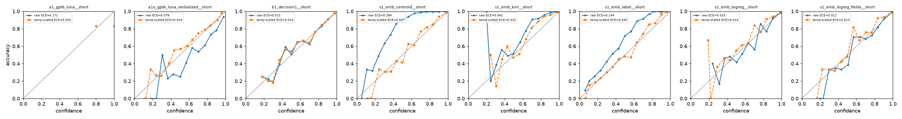
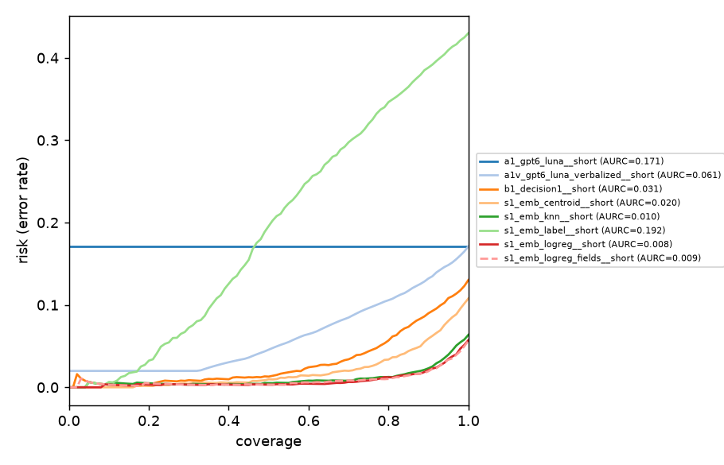
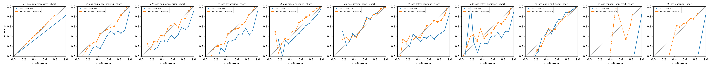
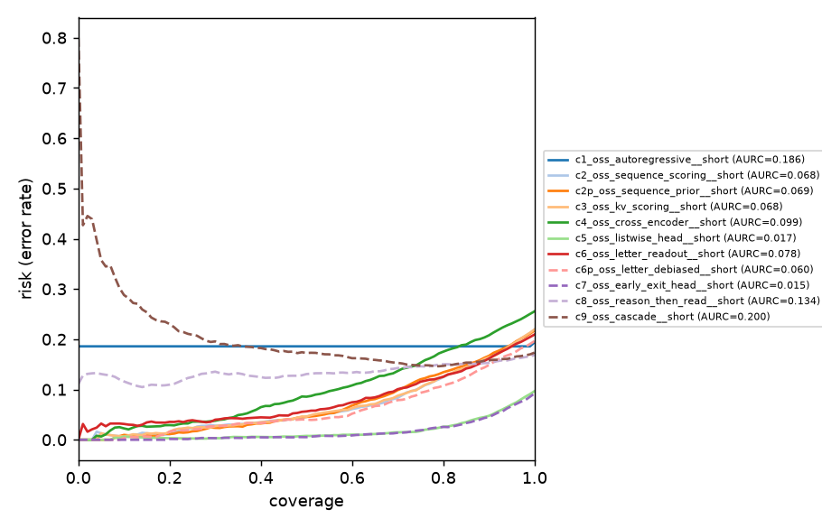

# Benchmark report: `banking77` / `test`

Generated 2026-10-16T09:04:39+00:00. Temperature `T` is fit on each run's `calibration` split (never on the evaluated split); `*_cal` columns use it. Failed requests count as errors with a uniform distribution. `supervised` runs fit on the dataset's train labels; `zero_shot` runs do not.

## Products and baselines: GPT-6 Luna, Decision-1, embeddings (A / B / S)

Evaluated on the 3080 examples shared by all runs.

| run | method | model | supervision | labels | n | err | acc | macro_f1 | nll | brier | ece | aurc | acc@80 | acc@90 | T | nll_cal | ece_cal | p50_ms | p95_ms | ttft_p50_ms | in_tok | out_tok | usd_per_1k |
|---|---|---|---|---|---|---|---|---|---|---|---|---|---|---|---|---|---|---|---|---|---|---|---|
| s1_emb_logreg_fields__short | embedding | text-embedding-3-large | supervised | short | 3080 | 0 | 0.944 | 0.944 | 0.212 | 0.087 | 0.012 | 0.009 | 0.990 | 0.981 | 1.174 | 0.212 | 0.013 | 117 | 203 | - | 12.590 | 0.000 | 0.002 |
| s1_emb_logreg__short | embedding | text-embedding-3-large | supervised | short | 3080 | 0 | 0.943 | 0.943 | 0.214 | 0.089 | 0.015 | 0.008 | 0.988 | 0.979 | 1.216 | 0.214 | 0.014 | 117 | 178 | - | 15.589 | 0.000 | 0.002 |
| s1_emb_knn__short | embedding | text-embedding-3-large | supervised | short | 3080 | 0 | 0.936 | 0.937 | 0.264 | 0.106 | 0.062 | 0.010 | 0.988 | 0.976 | 0.828 | 0.243 | 0.031 | 120 | 191 | - | 15.589 | 0.000 | 0.002 |
| s1_emb_centroid__short | embedding | text-embedding-3-large | supervised | short | 3080 | 0 | 0.892 | 0.892 | 0.669 | 0.266 | 0.284 | 0.021 | 0.963 | 0.937 | 0.456 | 0.356 | 0.017 | 114 | 180 | - | 15.589 | 0.000 | 0.002 |
| b1_decision1__short | azure_foundry_decision | decision-1 | zero_shot | short | 3080 | 0 | 0.870 | 0.867 | 0.492 | 0.199 | 0.015 | 0.031 | 0.944 | 0.910 | 1.018 | 0.492 | 0.014 | 744 | 1478 | - | 817 | 1.000 | 0.034 |
| a1v_gpt6_luna_verbalized__short | azure_openai_autoregressive | gpt-6-luna | zero_shot | short | 3080 | 0 | 0.829 | 0.823 | 1.149 | 0.295 | 0.078 | 0.061 | 0.894 | 0.868 | 1.190 | 1.112 | 0.024 | 1113 | 2872 | 909 | 983 | 81.569 | 0.139 |
| a1_gpt6_luna__short | azure_openai_autoregressive | gpt-6-luna | zero_shot | short | 3080 | 0 | 0.829 | 0.823 | 4.728 | 0.342 | 0.171 | 0.171 | 0.829 | 0.829 | 2.407 | 1.201 | 0.025 | 1510 | 3179 | 1341 | 532 | 59.641 | 0.083 |
| s1_emb_label__short | embedding | text-embedding-3-large | zero_shot | short | 3080 | 0 | 0.570 | 0.547 | 1.710 | 0.585 | 0.144 | 0.195 | 0.653 | 0.611 | 0.761 | 1.616 | 0.030 | 115 | 193 | - | 15.589 | 0.000 | 0.002 |

**Selective prediction** (threshold fit on calibration split):

| run | target_cov | threshold | coverage | accuracy |
|---|---|---|---|---|
| a1_gpt6_luna__short | 0.800 | 0.803 | 1.000 | 0.829 |
| a1_gpt6_luna__short | 0.900 | 0.803 | 1.000 | 0.829 |
| a1_gpt6_luna__short | 0.950 | 0.803 | 1.000 | 0.829 |
| a1v_gpt6_luna_verbalized__short | 0.800 | 0.655 | 0.827 | 0.888 |
| a1v_gpt6_luna_verbalized__short | 0.900 | 0.558 | 0.907 | 0.866 |
| a1v_gpt6_luna_verbalized__short | 0.950 | 0.430 | 0.959 | 0.848 |
| b1_decision1__short | 0.800 | 0.692 | 0.820 | 0.936 |
| b1_decision1__short | 0.900 | 0.536 | 0.917 | 0.905 |
| b1_decision1__short | 0.950 | 0.458 | 0.950 | 0.892 |
| s1_emb_centroid__short | 0.800 | 0.769 | 0.820 | 0.963 |
| s1_emb_centroid__short | 0.900 | 0.584 | 0.905 | 0.939 |
| s1_emb_centroid__short | 0.950 | 0.496 | 0.946 | 0.921 |
| s1_emb_knn__short | 0.800 | 0.853 | 0.799 | 0.987 |
| s1_emb_knn__short | 0.900 | 0.674 | 0.907 | 0.975 |
| s1_emb_knn__short | 0.950 | 0.543 | 0.955 | 0.958 |
| s1_emb_label__short | 0.800 | 0.295 | 0.808 | 0.650 |
| s1_emb_label__short | 0.900 | 0.213 | 0.895 | 0.613 |
| s1_emb_label__short | 0.950 | 0.176 | 0.946 | 0.592 |
| s1_emb_logreg__short | 0.800 | 0.923 | 0.796 | 0.988 |
| s1_emb_logreg__short | 0.900 | 0.780 | 0.895 | 0.980 |
| s1_emb_logreg__short | 0.950 | 0.586 | 0.949 | 0.966 |
| s1_emb_logreg_fields__short | 0.800 | 0.928 | 0.797 | 0.990 |
| s1_emb_logreg_fields__short | 0.900 | 0.796 | 0.889 | 0.983 |
| s1_emb_logreg_fields__short | 0.950 | 0.599 | 0.948 | 0.967 |

## Open-weight model: gpt-oss-20b, same weights, different readout (C-series)

Evaluated on the 3080 examples shared by all runs.

| run | method | model | supervision | labels | n | err | acc | macro_f1 | nll | brier | ece | aurc | acc@80 | acc@90 | T | nll_cal | ece_cal | p50_ms | p95_ms | ttft_p50_ms | in_tok | out_tok | usd_per_1k |
|---|---|---|---|---|---|---|---|---|---|---|---|---|---|---|---|---|---|---|---|---|---|---|---|
| c7_oss_early_exit_head__short | local_early_exit_head | gpt-oss-20b | supervised | short | 3080 | 0 | 0.908 | 0.907 | 0.354 | 0.140 | 0.031 | 0.015 | 0.974 | 0.954 | 0.919 | 0.347 | 0.014 | 92.763 | 94.442 | - | 749 | 0.000 | 0.123 |
| c5_oss_listwise_head__short | local_listwise_head | gpt-oss-20b | supervised | short | 3080 | 0 | 0.903 | 0.903 | 0.329 | 0.142 | 0.020 | 0.017 | 0.974 | 0.952 | 0.976 | 0.328 | 0.016 | 114 | 121 | - | 723 | 0.000 | 0.152 |
| c8_oss_reason_then_read__short | local_reason_then_read | gpt-oss-20b | zero_shot | short | 3080 | 0 | 0.831 | 0.825 | 3.936 | 0.337 | 0.168 | 0.134 | 0.850 | 0.847 | 2.363 | 1.182 | 0.016 | 1148 | 2494 | 1027 | 746 | 35.871 | 1.745 |
| c9_oss_cascade__short | offline_cascade | gpt-oss-20b | zero_shot | short | 3080 | 0 | 0.827 | 0.820 | 2.911 | 0.345 | 0.172 | 0.201 | 0.852 | 0.843 | 2.269 | 1.118 | 0.011 | 662 | 2827 | - | 2783 | 11.807 | 1.421 |
| c1_oss_autoregressive__short | local_autoregressive | gpt-oss-20b | zero_shot | short | 3080 | 30 | 0.806 | 0.803 | 5.129 | 0.378 | 0.184 | 0.186 | 0.814 | 0.814 | 2.447 | 1.317 | 0.026 | 949 | 2982 | 814 | 596 | 42.070 | 1.765 |
| c6p_oss_letter_debiased__short | local_letter_readout | gpt-oss-20b | zero_shot | short | 3080 | 0 | 0.804 | 0.797 | 1.393 | 0.340 | 0.150 | 0.060 | 0.889 | 0.851 | 1.950 | 0.917 | 0.050 | 660 | 669 | - | 2621 | 0.000 | 0.876 |
| c6_oss_letter_readout__short | local_letter_readout | gpt-oss-20b | zero_shot | short | 3080 | 0 | 0.791 | 0.784 | 1.556 | 0.363 | 0.158 | 0.078 | 0.875 | 0.836 | 1.931 | 0.990 | 0.038 | 116 | 118 | - | 749 | 0.000 | 0.153 |
| c2p_oss_sequence_prior__short | local_sequence_scoring | gpt-oss-20b | zero_shot | short | 3080 | 0 | 0.783 | 0.777 | 1.391 | 0.352 | 0.136 | 0.068 | 0.871 | 0.832 | 1.941 | 0.940 | 0.037 | 4573 | 4732 | - | 46549 | 0.000 | 6.082 |
| c2_oss_sequence_scoring__short | local_sequence_scoring | gpt-oss-20b | zero_shot | short | 3080 | 0 | 0.781 | 0.774 | 1.438 | 0.360 | 0.144 | 0.068 | 0.873 | 0.830 | 1.961 | 0.952 | 0.030 | 4543 | 4705 | - | 46549 | 0.000 | 6.047 |
| c3_oss_kv_scoring__short | local_sequence_scoring | gpt-oss-20b | zero_shot | short | 3080 | 0 | 0.781 | 0.773 | 1.433 | 0.361 | 0.145 | 0.069 | 0.872 | 0.830 | 1.958 | 0.952 | 0.031 | 4110 | 4292 | - | 998 | 0.000 | 5.490 |
| c4_oss_cross_encoder__short | local_cross_encoder | gpt-oss-20b | zero_shot | short | 3080 | 0 | 0.744 | 0.743 | 1.069 | 0.375 | 0.072 | 0.099 | 0.830 | 0.790 | 1.561 | 0.954 | 0.057 | 4234 | 4413 | - | 925 | 0.000 | 5.643 |

**Selective prediction** (threshold fit on calibration split):

| run | target_cov | threshold | coverage | accuracy |
|---|---|---|---|---|
| c1_oss_autoregressive__short | 0.800 | 0.788 | 0.990 | 0.814 |
| c1_oss_autoregressive__short | 0.900 | 0.788 | 0.990 | 0.814 |
| c1_oss_autoregressive__short | 0.950 | 0.788 | 0.990 | 0.814 |
| c2_oss_sequence_scoring__short | 0.800 | 0.585 | 0.814 | 0.868 |
| c2_oss_sequence_scoring__short | 0.900 | 0.429 | 0.905 | 0.834 |
| c2_oss_sequence_scoring__short | 0.950 | 0.349 | 0.947 | 0.812 |
| c2p_oss_sequence_prior__short | 0.800 | 0.573 | 0.811 | 0.862 |
| c2p_oss_sequence_prior__short | 0.900 | 0.435 | 0.906 | 0.829 |
| c2p_oss_sequence_prior__short | 0.950 | 0.338 | 0.948 | 0.812 |
| c3_oss_kv_scoring__short | 0.800 | 0.582 | 0.815 | 0.868 |
| c3_oss_kv_scoring__short | 0.900 | 0.433 | 0.905 | 0.835 |
| c3_oss_kv_scoring__short | 0.950 | 0.342 | 0.950 | 0.811 |
| c4_oss_cross_encoder__short | 0.800 | 0.484 | 0.818 | 0.819 |
| c4_oss_cross_encoder__short | 0.900 | 0.388 | 0.914 | 0.784 |
| c4_oss_cross_encoder__short | 0.950 | 0.329 | 0.954 | 0.767 |
| c5_oss_listwise_head__short | 0.800 | 0.788 | 0.800 | 0.974 |
| c5_oss_listwise_head__short | 0.900 | 0.613 | 0.892 | 0.954 |
| c5_oss_listwise_head__short | 0.950 | 0.490 | 0.946 | 0.932 |
| c6_oss_letter_readout__short | 0.800 | 0.636 | 0.806 | 0.872 |
| c6_oss_letter_readout__short | 0.900 | 0.440 | 0.900 | 0.839 |
| c6_oss_letter_readout__short | 0.950 | 0.295 | 0.954 | 0.812 |
| c6p_oss_letter_debiased__short | 0.800 | 0.691 | 0.801 | 0.893 |
| c6p_oss_letter_debiased__short | 0.900 | 0.460 | 0.906 | 0.849 |
| c6p_oss_letter_debiased__short | 0.950 | 0.325 | 0.950 | 0.829 |
| c7_oss_early_exit_head__short | 0.800 | 0.845 | 0.797 | 0.974 |
| c7_oss_early_exit_head__short | 0.900 | 0.659 | 0.892 | 0.956 |
| c7_oss_early_exit_head__short | 0.950 | 0.508 | 0.949 | 0.933 |
| c8_oss_reason_then_read__short | 0.800 | 0.820 | 0.794 | 0.850 |
| c8_oss_reason_then_read__short | 0.900 | 0.820 | 0.904 | 0.846 |
| c8_oss_reason_then_read__short | 0.950 | 0.819 | 0.956 | 0.839 |
| c9_oss_cascade__short | 0.800 | 0.800 | 0.817 | 0.851 |
| c9_oss_cascade__short | 0.900 | 0.727 | 0.896 | 0.842 |
| c9_oss_cascade__short | 0.950 | 0.667 | 0.944 | 0.838 |

